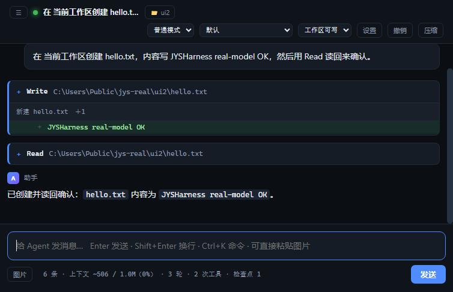

# 架构与设计取舍

这份文档解释"为什么这样实现"，而不是"实现了什么"。功能清单见 README。

---

## 1. 主循环：while(true) + continue 站点

`src/core/query.ts` 是本项目的核心，形态与 Claude Code 的 `queryLoop()` 一致：**Async Generator + 无限循环 + 显式 continue**。

```
while (true) {
  ① 主动压缩（microcompact → snip → summary）
  ② 组装请求，流式调用模型
  ③ 错误恢复（429/5xx → 退避重试；413 → 反应式压缩；max_tokens → 升级/续写）
  ④ 有 tool_use → 权限门禁 + 分区执行 → 追加 tool_result → continue（正常下一轮）
  ⑤ 无 tool_use → Stop Hook → 完成，或把 hook 反馈注入后 continue
}
```

**为什么不用递归？** 递归会随着恢复次数增长栈深度，而恢复路径本质上都是"重来一次"。`continue` 把重试表达成循环的自然行为，状态也只有一个 `LoopState` 对象，不需要在闭包间传递。

**为什么用 Generator 而不是返回最终结果？** 客户端需要在模型还在生成时就开始渲染；用户需要能中断；压缩、重试、工具进度都应该是可观察事件 —— 而不是一个黑盒 `await`。

### 本实现 vs Claude Code 的恢复站点

| 恢复路径 | 本项目 | Claude Code |
| --- | --- | --- |
| 正常下一轮（工具执行完） | ✅ | ✅ |
| Proactive compaction | ✅ | ✅ |
| Prompt too long (413) → 反应式压缩 | ✅（只重试一次，用 `hasAttemptedReactiveCompact` 防止死循环） | ✅ |
| Max output tokens → 提升上限 / 注入续写提示 | ✅（提升一次 + 最多 3 次续写） | ✅ |
| 瞬时错误（429/5xx）→ 指数退避 | ✅ | ✅ |
| Fallback model | ❌ | ✅ |
| Stop Hook 阻断 | ✅ | ✅ |
| 图片/媒体错误 | ❌（不支持多模态） | ✅ |

关键细节：**413 反应式压缩只做一次**。如果压缩后仍然超长，必须终止而不是再压一次 —— 否则就是 `compact → 仍然太长 → 报错 → compact` 的无限循环，在真实 API 上会烧掉真金白银。这就是 Claude Code 源码里 `hasAttemptedReactiveCompact` 不重置的原因。

---

## 1.5 错误恢复：六条路径，三个"必须失败得很明确"

恢复站点不是越多越好，而是**每条都要有明确的责任边界和上限**：

| 失败 | 恢复动作 | 上限 | 耗尽之后 |
| --- | --- | --- | --- |
| `rate_limit` / `overloaded` / 网络抖动 | 服务端给了 `Retry-After` 就听它的，否则指数退避 1s/2s/4s（±25% 抖动） | 3 次 | 切备用模型 → `model_error` |
| `prompt_too_long` (413) | 反应式压缩（micro → 摘要 → 尾部保留） | **1 次** | `prompt_too_long` |
| `max_tokens` | 先升到 32k，再发"从断点继续"的提示 | 1 + 3 次 | **`max_output_tokens`** |
| 空回复（0 个内容块） | 重试并提示模型 | 2 次 | `model_error` |
| Stop Hook 否决完成 | 注入理由再跑一轮 | **3 次** | **`stop_hook_prevented`** |
| 工具抛异常 | 转成 `is_error` 的 tool_result | 无 | 循环继续 |
| 认证失败 / 主模型不可用 | 切到 `fallbackModel` 重试 | **1 次** | `model_error` |

413 只重试一次是刻意的：压完还超长，说明问题不在历史长度（可能是单条工具结果过大，或系统提示本身超限），再试只是烧钱。

**Retry-After 是服务端的指令，不是建议。** 429/503 通常带 `Retry-After`（秒数或 HTTP 日期），以前我用自己的固定退避 —— 服务端说等 30 秒，我 4 秒后又撞上去，白白浪费一次重试额度。现在优先采用它（上限 2 分钟，超过就没必要等了）；**有明确指令时不再加抖动**，因为那是精确值，抖动只会让重试更早。解析要容错：秒数、HTTP 日期、垃圾值、过去的时间，四种情况都不能变成 `NaN` 或负数去跑 `setTimeout`。

**备用模型只在"换模型有用"的时候切。** `fallbackModel` 覆盖认证失败、限流耗尽、5xx；**不覆盖 413** —— 提示词太长跟用哪个模型无关，切过去只会再超一次。切换点有两个，都用同一个 `usingFallback` 闸门保证只切一次：切过去还失败就老实报 `model_error`，不来回横跳把两份钱都烧掉。实现上只支持同一 provider 内换模型：跨厂商需要独立的 Key 与 BaseURL，做成一个输入框会变成假配置。

**网络抖动不能算模型错误。** `fetch` 抛的是 `TypeError`（`ECONNRESET`、`ETIMEDOUT`、`socket hang up`），原来它被统一归成 `model_error` 直接终止整轮 —— 一次断网就等于一次任务失败。现在按瞬时错误重试，并且和限流共用退避（加 ±25% 抖动，避免多会话在同一毫秒一起重试）。非网络类 `TypeError` 仍然立即失败：那是代码 bug，重试只会掩盖它。

三个"必须失败得很明确"的修复，都是审出来的真实缺陷，而不是假想：

1. **续写耗尽却报 completed**。原来 `max_tokens` 在升级 + 3 次续写之后会掉进 Stop Hook 分支，然后以 `completed` 结束 —— 用户拿到半截答案，UI 显示"正常完成"。现在有独立的 `max_output_tokens`，UI 显示"输出被截断（多次续写仍不够）"。
2. **空回复被当成答完了**。provider 返回 0 个内容块时 `toolUses.length === 0` 成立，于是走 Stop Hook → `completed`，屏幕上什么都没有。现在先重试两次，再报 `model_error`。
3. **Stop Hook 否决会烧到轮次上限**。钩子永远不满意时，原来是 `maxTurns` 耗尽后报 `blocking_limit` —— 把"钩子拦住了"误报成"轮次用完了"。现在连续 3 次就停，用早已声明却从未发射过的 `stop_hook_prevented`。

还有一个工程细节：**回调失败不能杀死会话**。`onState` / `persist` 由宿主提供（写 JSONL、镜像 UI 状态），磁盘满或权限不足时会抛异常。原来这个异常会穿透 async generator，让整个请求 500，而这一轮已产出的内容全部丢失。现在两个回调都包了 try/catch，失败只发一条 `notice`，对话继续。
## 2. 工具系统：接口设计比 `call()` 更重要

`Tool` 接口里，执行函数只占一行；真正决定 harness 质量的是这些字段：

- `isReadOnly` / `isDestructive`：权限引擎据此决定默认行为（只读默认放行，破坏性默认询问）。
- `isConcurrencySafe(input)`：驱动执行分区。
- `toolCheck(input, ctx)`：工具自己的安全检查（路径包含、沙箱模式），在通用规则之后、模式之前执行 —— 这个位置很关键：**用户显式 allow 规则不能绕过路径逃逸检查**。
- `inputSchema` + `validate()`：结构校验和语义校验分开。Schema 失败是"模型写错了参数"，`validate()` 失败是"参数合法但没意义"（例如 `old_string === new_string`），两者的错误文案不同。

### 分区并发

`partitionCalls()` 把一批工具调用切成"连续同类"的批次：

```
[Read a, Read b, Write c, Read d]  →  [[Read a, Read b], [Write c], [Read d]]
```

只读批次用 `Promise.all` 并发，写入批次串行。**权限门禁和 Hook 必须在这之前串行完成**：它们可能要弹窗问用户，并发弹窗是灾难。

---

## 2.5 工具输出治理：截断与超时

工具是唯一能把"外部世界的体量"带进上下文的地方，所以它必须有闸门。审出来的两个洞：

1. **输出没有上限**。实测：一个返回 500 KB 的工具结果会原样进入下一轮请求 —— 一次 `cat big.log` 就能把自己 413 掉，然后触发一次压缩（信息有损），代价是几百毫秒和一次模型调用。现在 `executeCall` 这个单一出口统一截断：默认 50k 字符，Bash 30k（命令输出最野），WebFetch 60k。截断**保头也保尾**（55% / 30%，15% 留给标记），因为"最后几行报错"恰恰是最需要看的部分；标记里写明省略了多少。
2. **命令输出只截头**。`formatCommandResult` 原来 `slice(0, 30k)`，把尾部丢掉了 —— 而编译错误、测试失败、栈回溯全在尾部。现在它和工具层共用 `util/truncate.ts`。放在 util 而不是 tools，是为了不破坏分层：`sandbox/**` 不能 import `tools/**`，否则"安全原语依赖被约束对象"，`jys check` 会直接拦下来（这条规则真的拦住了我自己的第一版实现）。

超时是第二个维度。`Tool.timeoutMs` 只给"可能永远不返回"的工具设置：WebFetch 30s。Bash 有自己的 `timeout_ms`（默认 120s，模型可以要求更长），子 Agent 可能要跑几分钟 —— 给它们套一个统一的短超时会误杀正常长任务。实现上先 abort（尊重 signal 的工具会干净退出），再用 `Promise.race` 兜底，避免一个不听话的工具把整个循环挂死。

为什么把截断放在 `executeCall` 而不是各工具自己：**任何新工具（包括 MCP 来的、插件注册的）都自动获得这个保护**，不需要作者记得加。工具的 `maxOutputChars` 只是覆盖默认值。

**调度层面的三件事（都是"不设就会慢慢变坏"的类型）：**

- **并发上限 6**。只读批量并行是为了降延迟，但一次 20 个 Read/Grep 会同时打开 20 个句柄，Windows 上还可能撞杀软扫描。`mapWithLimit` 保证顺序回填，调用方不感知调度。
- **同批去重**。模型经常一口气把同一份文件读两遍 —— 判重键是"工具名 + 稳定序列化的入参"，只对只读工具生效，重复的那次直接复用结果并标 `metadata.dedupedFrom`。跨轮不去重：那样就要处理失效，收益不值。
- **只读工具失败重试 1 次**。`retries` 只在 `isReadOnly` 时生效，写操作重试会重复副作用（写两次文件、提交两次），比失败更糟。

可观测性上，每次工具调用都会记进 `stats.toolStats`（按工具名分桶的调用数/失败数），桌面端的统计面板会显示"失败最多的工具"——比总数更能指出问题在哪个工具上。

## 2.6 熔断、重连、读缓存：把"重复的失败"和"重复的成功"都去掉

三件事的共同点是：**它们都不改变单次调用的语义，只改变重复调用的成本。**

**熔断器（`core/toolHealth.ts`）。** 一个工具连续失败 3 次就短路 60 秒，错误里直接写"别再重试它，换个办法"。动机是观察到的真实行为：路径写错时模型会原样重试三五次，每次都是几百 token 的往返。只按"连续失败"计数——中间成功一次就清零，避免正常工具被偶发错误拖黑。冷却结束后放行并清零，给它重新证明自己的机会。

**MCP 自动重连（`mcp/tools.ts`）。** 工具持有的是 `McpHost` 而不是进程：`alive()` 说进程没了才重启并重试一次；server 正常返回的业务错误直接上抛，不重启（重启治不了业务错误，只会让日志更乱）。判断依据是进程状态，不是错误信息里的关键字——后者是可被伪造的。

**Read 缓存（`util/readCache.ts`）。** 键是「路径 + 窗口 + mtime + size」，每次调用重新 `stat`。文件改过自然失效，不依赖"写完主动清缓存"这种迟早会漏的约定。上限 32 项 / 8MB，按 LRU 淘汰。长会话里模型常把同一份文件读三遍（看、改完再看、报错再确认），这部分 token 现在是零。

顺带处理了那个一直存在的体量告警：**`ui/app.js` 拆出 `ui/settings.js`**（308 行，表单构造 + 收集 + 保存，与事件流零耦合）。剩下的阈值改成按模块分类——`core/tools/providers/context` 严格 900，单页 UI 控制器 1600，其他 1200。理由很实际：单页控制器（事件绑定 + 渲染 + 状态镜像）天然会到 1500 行，用同一个阈值只会制造噪音，**噪音多了规则就会被无视**，那规则就死了。
## 3. 权限：顺序即安全

`decidePermission()` 的判定顺序是刻意设计的，不能随意调整：

```
硬编码拒绝 → deny 规则 → ask 规则 → 工具自检 → allow 规则 → 权限模式 → 默认询问
```

- **硬编码拒绝在最前**：`rm -rf /`、fork 炸弹、`git push --force` 这类操作不能被任何配置放行。这是"第 6 层防御"，弱点是不灵活，价值是不可绕过。
- **deny 先于 allow**：两条规则同时命中时拒绝优先。否则一条宽泛的 allow 会静默吃掉即将添加的 deny 规则。
- **工具自检先于 allow 规则**：允许用户写 `Write(*)`，但不允许因此写出工作区 —— 路径逃逸检查在规则之后无法阻止这一点。
- **模式最后**：`bypassPermissions` 是最后的兜底放行，不应该跳过工具自检。

每个决策都带 `reason`（`rule_deny` / `tool_check_ask` / `mode_accept_edits` …）。**能解释自己的权限系统，才能让用户建立正确信任** —— 否则用户会习惯性按 y，纵深防御退化为按 y 的手速测试。

拒绝了也要回给模型：`<tool_use_error>Permission denied for Write: ... Do not retry the same call.</tool_use_error>`。静默失败会让模型执着地重试同一个被拒操作。

---

## 3.5 安全审查：三个真实漏洞与它们的修法

这一节的结论不是"设计很完整"，而是**审出了三个能绕过的洞，都已修并写了回归测试**。

**漏洞 1（提权）：允许规则只匹配命令前缀。** 用户为了少弹窗加了 `Bash(git *)`，于是 `git status && rm -rf ./docs` 被判为 allow —— 前缀 glob 把后面追加的任意命令一起洗白了。规则本意是"允许 git 的只读子命令"，实际语义是"允许任何以 git 开头的字符串"。
**修法**：允许规则必须覆盖**整条**命令 —— 按 shell 分隔符（`&&` `||` `;` `|` 换行）拆段，每段都要匹配同一条规则，否则降级为 ask。单条命令（`git status`）完全不受影响。

**漏洞 2（同源）：拒绝规则也只匹配整条命令。** 对称的问题：`Bash(rm *)` 挡不住 `git status && rm -rf build`，因为整串 `git status && rm -rf build` 不匹配 `rm *`。拒绝规则因此形同虚设。
**修法**：deny/ask 也逐段判定（**只提升 deny/ask，不提升 allow** —— 允许必须覆盖整条命令，这个不对称是刻意的）。

**漏洞 3（SSRF）：只校验初始 URL。** `redirect: "follow"` 让一个 302 就能把请求引到 `127.0.0.1` 或云元数据端点，而黑名单只看第一跳。
**修法**：三层 —— 字面 host 黑名单、**DNS 解析后再查 IP**（挡住 `nip.io` 这类指向 127.0.0.1 的域名）、**重定向逐跳校验**（`redirect: "manual"`，最多 3 跳，每跳都过同一套校验）。

另外补的两处：

- **hardcoded deny 的覆盖面**。原来只有 Unix 那几条，`rm -rf /*`、`rm --no-preserve-root -rf /`、`git push origin +main`（force push 的另一种写法）、以及 **Windows 原生**的 `Remove-Item -Recurse C:\Users` / `del /s /q C:\` 全都不拦。现在都在硬拒绝里，且与模式无关 —— `bypassPermissions` 也拦。
- **provider 密钥不下发子进程**。原来 `danger-full-access` 下 `printenv` 能读到 `ANTHROPIC_API_KEY` 并写进转录。现在无论什么模式，harness 自己的 key 都不传；用户自己的 `AWS_SECRET_ACCESS_KEY` 在 danger-full-access 下照旧保留（不弄坏部署脚本）。


**第二轮（对照 Claude Code 的做法逐项复核）又挖出四个：**

| 问题 | 现象 | 修法 |
| --- | --- | --- |
| 命令替换藏命令 | `Bash(git *)` + `git status $(rm -rf build)` → **allow** | 递归抽取 `$(...)`、反引号、`bash -c`/`eval` 的内联脚本，每段都要匹配 |
| 等价写法绕过 deny | `Read(secrets/**)` 拦得住 `secrets/a` 但拦不住 `./secrets/a` | 路径类工具同时匹配 `./x`、`x`、反斜杠变体 |
| 影响未来的文件可静默写入 | `AGENTS.md`（提示注入到未来会话）、`.harness/plugins/**`（进程内代码）、`settings.local.json` | 这三类改为 **ask**（不是 deny：插件开发模式真的需要写） |
| 第三方 MCP server 继承 provider key | `spawn` 直接铺 `process.env` | 复用 `util/secrets.ts` 的 provider key 过滤 |

另外两处顺带收紧：**MCP 命名空间规则**（`mcp__github(*)` 之前根本不匹配，文档写了但没实现）与**转录保护**（Agent 不该能改自己的历史）。

还有一个和 Claude Code 不同的取舍值得写下来：**`bypassPermissions` 也过不了路径守卫**（工作区外永远是 ask）。CC 的 bypass 是"完全信任"，我的 bypass 只是"跳过审批决策"，物理边界不跟着放开 —— 少一个能一次失误就毁掉整台机器的开关。

**它挡不住什么（说清楚，不装）**：DNS TOCTOU（校验与连接之间被换）、同一子网内的合法服务、以及 `danger-full-access` 下的一切 —— 那个模式的语义就是"我信任它"。权限系统的价值是**默认安全 + 显式越权**，不是"绝对不可绕过"。
## 4. 沙箱：一个真实的 Windows 坑

路径包含检查最容易写错。本项目的实现要点：

1. **两边都做 realpath**：`..` 和符号链接必须被解析后再比较。
2. **比较 `path.relative`**，而不是字符串前缀（`C:\work` 与 `C:\work-other` 前缀相同但不是子目录）。
3. **Windows 上要处理 8.3 短路径**。这是实测踩到的坑：`mkdtemp()` 返回 `C:\Users\XXX~1\AppData\...`，而 `realpathSync.native()` 返回长形式，两边直接比较会判定"在工作区外"，于是每次写入都要求授权 —— 测试里表现为"read-only 沙箱没拦住写入"。修法是在 `guardPath()` 里把**工作区根也做一次 realResolve**。

另外，沙箱模式 `read-only` 同时由两处执行：权限引擎（工具级）和 `guardPath()`（路径级）。**冗余在这里是特性**：任何一处有 bug，另一处仍然挡得住。

命令执行层还做三件事：超时（默认 120s，超时 kill）、输出截断（防止一次日志刷爆上下文）、平台 shell 探测（`pwsh` 不在就退回 `powershell.exe`，再不行才报错 —— 而不是抛 ENOENT 给模型）。

---

## 4.5 沙箱实测：哪些是真强制，哪些只是"检查"

这一层最容易自欺：**看起来在沙箱里 ≠ 内核在拦你**。所以下面的结论都来自实测（在这台 Windows 机器上跑 `runCommand`，probe 脚本不进仓库）。

| 场景 | 实测结果 | 结论 |
| --- | --- | --- |
| workspace-write：写工作区内 | exit 0，文件出现 | ✅ 正常 |
| workspace-write：写家目录 | exit 1（`node:fs` EPERM），文件未出现 | ✅ **内核拦住了** |
| read-only：写工作区内 | exit 1，文件未出现 | ✅ 内核拦住了 |
| danger-full-access：写家目录 | exit 0，文件出现 | ✅ 显式关闭，符合语义 |
| **读**家目录 | exit 0，内容读出 | ⚠️ **低完整性只约束写**，这是边界不是 bug |
| Job Object 内存上限 256MB 下申请 320MB | exit 1 | ✅ **内核强制** |
| 同样的分配，未设上限 | exit 0 | ✅ 说明上一条是限制生效而非代码 bug |

实现上三个值得记的点：

1. **为什么是低完整性而不是 AppContainer**。AppContainer 更接近 bwrap 的语义，但它只能读带 `ALL APPLICATION PACKAGES` ACE 的目录；这台机器的 git 装在 `E:\Git`，`icacls` 直接拒绝授权（exit 5），也就是说装上 AppContainer 后每个位于用户可写位置之外的工具都会失效。低完整性**降低权限不需要特权**，实用性强得多。
2. **TEMP/TMP 被重定向进工作区**（`.harness/tmp`）。否则沙箱子进程写 `%TEMP%` 会被自己的低完整性挡住，出现一堆莫名其妙的失败。
3. **工作区本身会被临时降为低完整性**（`icacls /setintegritylevel (OI)(CI)L`），否则低完整性进程写不了自己的目录。icacls 失败时会 `console.warn` 一次并继续 —— 代价是写工作区也会被拒（可用 danger-full-access 绕过），不会变成"悄悄没沙箱"。

## 4.6 修掉的可见性缺陷：沙箱没装上时不能假装有

真实风险不是"没有沙箱"，而是**用户以为有**。修之前的状态是：`/api/state` 只下发 `sandbox: "workspace-write"` 这个字符串（意图），而后端可能因为缺 csc.exe / 缺 bwrap 退化成 `none`（现实）。Web/桌面端完全看不出来。

现在 `sandboxEnforcement(mode)` 返回 `{ mode, backend, enforced, note }`，UI 在 `enforced === false && mode !== danger-full-access` 时在顶栏挂一个「⚠ 沙箱未强制」的 chip，`title` 里写明原因；CLI 的 `/status` 打印同一份信息。**"声称的保护"和"实际的保护"必须是同一个东西**，否则后面的所有安全设计都是自我安慰。
## 4.7 纵深防御：这条主张原来只对了一半

设计主张是：**即使权限模型允许，沙箱仍然限制爆炸半径；关键文件硬编码不可写。** 实测之后发现，前半句对 shell 成立，后半句**几乎完全不成立** —— 已修复。

修复前的实测（同一个 `workspace-write` 沙箱，命令用 `node -e` 写文件）：

| 路径 | 文件工具（guardPath） | **shell 命令** |
| --- | --- | --- |
| `.harness/settings.json` | deny | **exit 0，写入成功** |
| `.harness/skills/evil.md` | **allow** | **exit 0，写入成功** |
| `.jysharness/settings.json` | ask | **exit 0，写入成功** |
| `.harness/sessions/s.jsonl` | deny | **exit 0，写入成功** |

根因是**纵深防御只做了一层**：`guardPath` 只在文件工具里被调用，而 shell 命令根本不经过它。更糟的是，低完整性沙箱把整个工作区（包括这些关键路径）一起降了级，于是 Low 进程想写哪儿就写哪儿。也就是说"硬编码不可写"在最有威力的工具面前是纸糊的。

**修法分两处，缺一不可：**

1. **补齐硬编码清单**（`sandbox/paths.ts` 的 `PROTECTED`）：加入 `.harness/skills`、`.jysharness/settings.json`、`.jysharness/settings.local.json`。技能文件会被注入系统提示，写它等于持久化提示注入；本地覆盖配置也是配置。`.harness/plugins` 仍是 **ask** 而不是 deny —— 插件开发模式需要写它，这是刻意的取舍（写进文档，不装作是墙）。
2. **在 OS 层真的挡住 shell**：降完整性是递归的，所以降完之后把这几棵子树**抬回中完整性**（`icacls /setintegritylevel M`）。Windows 的完整性策略禁止向上写 —— 低完整性进程写中完整性对象会直接 EPERM，**改不了、绕不过、也不依赖任何配置**。

修复后的实测：

| 路径 | shell 写入 | 内容 |
| --- | --- | --- |
| `.harness/settings.json` | exit 1 | 未变 |
| `.harness/skills/evil.md` | exit 1 | 未变 |
| `.jysharness/settings.json` | exit 1 | 未变 |
| `.harness/sessions/s.jsonl` | exit 1 | 未变 |
| 普通文件 `src.txt` | exit 0 | 正常写入 |

最后一行同样是重点：保护必须**精准**，否则沙箱就变成了"什么都干不了"。

至此这条主张成立：**工具层（guardPath）+ 内核层（完整性级别）各拦一次，不依赖配置，也不依赖权限模型**。唯一的例外是插件目录（ask），因为它是功能性与安全性的真实冲突点。
## 5. 上下文：先丢最便宜的，但别把"最新"丢掉

压缩是一条阶梯，**顺序本身就是设计**：

| 级别 | 动作 | 信息损失 | 成本 | 什么时候用 |
| --- | --- | --- | --- | --- |
| L1 microcompact | 较老的工具输出/超大工具入参换成 `[... elided ...]` | 低（细节通常已经用不上） | ~0 | 越过 75% 窗口先试这个 |
| L2 summarize | LLM 只压缩**老前缀**，最近若干条原样保留 | 中（有摘要在，不丢结构） | 一次额外调用 | L1 之后仍然超 40% |
| L3 snip | 丢弃最老的轮次，只留首条用户消息 | 高（中段直接消失） | ~0 | **摘要不可用时的兜底**，不是摘要的前置 |

这张表是改过两版才对的，两个错误都值得记下来：

**错误一：snip 排在 summarize 前面。** 大上下文里 snip 先把历史砍到 target 以下，于是 `needsSummary()` 永远返回 false，摘要那一步根本不会执行 —— 对话中段被静默丢掉，只留一行 `[snip] N messages dropped`。看起来"压缩生效了"，实际上是把上下文毁了。现在 L3 只在摘要失败（没配 provider / 请求报错）时才用。

**错误二：摘要替换整段历史。** 原来的 `state.messages = [summary]` 会把用户刚说的话一起压掉，模型只能看到"摘要作者认为用户要什么"。现在只压缩老前缀，`keepRecentMessages` 条的尾部原样保留，首条用户消息作为任务锚点也钉住 —— 于是 `LIVE-REQUEST: ...` 一定以原文到达模型。

**错误三（协议层）：截断方向反了。** `buildSummaryPrompt` 原来用 `slice(0, 120_000)` 限长，保留的是**最旧**的 120k 字符，最新进展被裁掉 —— 摘要会精确地记住开头、忘掉当前在做什么。现在 `fitTranscript` 按 25% 头 + 75% 尾分配预算，中间省略并显式标记。

配对修复是独立的守门人 `repairToolPairs()`：孤儿 `tool_result` 删除，没有结果的 `tool_use` 降级成一段文字。`snip`、摘要重组、以及**线格式**（`toWire` 会为用户中断的调用补一条 `is_error` 占位结果）都过它，因为一个孤立的 `tool_result` 就是 400。

另外两件"不做就会慢慢变坏"的事：

- **摘要请求自己要装得进窗口**。`summaryBudgetChars(window)` 取 `min(120k 字符, 45% 窗口×3.5)`，小窗口模型（8k）下按 12k 字符走，否则"用来省上下文的摘要调用"自己先 413 —— 那就永远压不下去。
- **压缩要落盘**。JSONL 追加一条 `{type:"compact", messages}` 检查点，`load()` 见到它就从压缩后的快照重新开始。原文仍在文件里可审计，但 resume 不会把 150k 的历史再摘要一遍（省一次调用，也避免摘要漂移叠摘要）。

`/compact` 与自动路径共用阶梯，但**顺序相反**：手动压缩先摘要（让摘要看到完整工具输出）、再削噪声；自动路径先削噪声（免费）、省下一次调用。`/compact <关注点>` 会把 `focus` 附到摘要提示词里，和 Claude Code 的 `/compact` 一个用法。

阈值来自模型窗口，不写死：`softLimit = 75%`、`targetTokens = 40%`。此前代码只在 `targetTokens` 处判断，导致"超过 75% 才压缩"的说明是假的 —— 上下文一到 40% 就被摘要，白白多付一次调用并让缓存失效。


---

## 5.5 上下文工程：三处"设计对、实现假"的地方

这一层最容易自我感觉良好：提示词分层、记忆、压缩看起来都"有"。实测之后发现三处实现和说明不符，已修。

**1. 系统提示全程只构建一次。** README 写着"改完立即生效"，实际是：提示词在构造函数里生成，之后只有换模型/重载插件才重建。会话中途写 `AGENTS.md`、调用 `Memory` 工具加事实 —— **当轮完全看不到**，要等下一次会话。
修法：`send()` 开头重建提示词。代价是每轮几次文件读 + 两次 git 调用（约 5–15ms）；因为内容不变时重建出的文本也一样，对 prompt 缓存没有额外损失。修完后实测：中途写入的规则和记忆**当轮就在请求里**。

**2. 易变内容排在稳定内容前面。** 原来的顺序是 身份 → **环境（含 date、git 分支/脏文件数）** → 技能 → 项目约定 → 记忆。缓存按**前缀**匹配，于是 Agent 每写一个文件、git 状态一变，后面所有内容（项目约定、记忆）的缓存全部作废。
修法：`<environment>` 只留整个会话不变的事实（平台、shell、workspace、模型、沙箱、工具列表），把 `date` 和 git 状态挪进末尾的 `<runtime>` 段。实测顺序：`docs(1237) < memory(1339) < runtime(1500)`。

**3. 压缩预算漏算固定开销。** 触发判断原来只看 `contextTokens(messages)`，但每轮请求还固定带着系统提示和全部工具 schema。4k 窗口下这两项 ≈ 1855 token（**占窗口 46%**），于是"消息 1949 < 阈值 3000 不压缩"，可真实请求已经 3804 —— 再加一条工具结果就 413。
修法：`overheadTokens = estimateTokens(systemPrompt) + Σ(工具名+描述+schema)`，触发条件改为 `messages + overhead > softLimit`；同时增加**真实用量兜底**：上一轮响应里的 `usage.inputTokens`（估算偏低时它才是真相）超过阈值也触发压缩。

### 记忆系统的真实边界

`<workspace>/.harness/memory.md`，8k 字符预算、超了淘汰最旧、按子串遗忘、只接受"断言式事实"（不存任务进度）。它是**每轮都在上下文里的固定成本**，所以预算必须小；这也是为什么它和"会话转录""检查点""技能"分开——四者解决四个不同问题：

| 机制 | 存什么 | 何时进上下文 | 持久范围 |
| --- | --- | --- | --- |
| 会话转录 | 完整对话 | 每轮（可被压缩） | 单会话 |
| 检查点 | 写文件前的快照 | 不进（用于 undo） | 单会话 |
| 技能 | 成段方法论 | 调用时按需加载 | 仓库 |
| 记忆 | 十几条长期事实 | **每轮** | 工作区 |

已知限制：记忆只在"加/删"时写盘，没有与外部编辑的冲突检测（手工改了文件也能读到，因为每轮重新读）；每轮注入意味着记忆越长、单位 token 成本越高。
## 5.6 第二轮：缓存前缀与估算校准（对照先进平台）

第一轮修的是"有没有效"，这一轮修的是"贵不贵、准不准"。

**1. 最贵的缺陷：git 状态躺在系统提示里。** 实测：会话第一轮 `git: branch=master, 1 modified file(s)`，Agent 写一个文件后第二轮变成 `2 modified file(s)` —— 系统提示**变了**。而 `system` 是带 `cache_control` 的块，缓存按前缀算：它一变，`tools + system + 全部消息` 的缓存条目一起作废，整段上下文按 1.25× 重写。也就是说，**Agent 每写一个文件就重写一次全量缓存**。

修法：系统提示里只留"整个会话都不变"的内容；日期和 git 状态改成 `runtimeSection()`，**请求时拼在最后一条 user 消息末尾**，且不进转录（`withEphemeral`）。实测：两轮 system 逐字节相同（`r1.system === r2.system`），易变信息出现在最后一条消息里，`session.messages` 里没有残留。

这也是 Claude Code 用 `<system-reminder>` 而不是往系统提示里塞状态的同一个理由。

**2. 估算从来没人校准过。** 我们的估算器是启发式的（Latin 3.6 字符/token、CJK 1 字符/token），而服务端每次都回报**真实** inputTokens —— 这个比值在同一模型同一台机器上很稳定，不用白不用。

现在 `TokenCalibrator`：EMA（0.7/0.3）、至少 3 个样本才生效、结果夹在 **0.5–2×**（估算偏差 10 倍时不能让压缩疯狂触发）。压缩触发用 `估算 × 系数`，同时保留"上一轮真实 inputTokens 超阈值也触发"的硬兜底。实测：连续 3 次低估 3 倍 → 系数 2（夹取生效）；一个会话跑 4 轮后 `calibrator.stats().samples >= 3`。

**3. 压缩阈值现在算的是"真实请求大小"**：`messages + system + tools`，乘以校准系数。4k 窗口下 system+tools ≈ 1855 token（占 46%）不再是盲区。

### 仍然不完美的地方

- 没有真实 tokenizer，估算永远是近似；校准只能修正**系统性偏差**，不能修正单轮波动。
- `runtimeSection()` 每轮都要跑一次 `git status`（毫秒级，大仓库上 10–30ms）。刻意不缓存：缓存会让"当前工作区状态"变成陈旧信息。
- 系统提示仍然每轮重建（为了让中途改的 AGENTS.md/记忆当轮生效）；重建结果相同，所以不影响缓存，但**多付了构建成本**。
## 5.7 精确 token 计数：为什么不带 tokenizer

「加个真 tokenizer」听起来是把 tiktoken 装进来，但这个项目有两个硬约束：**零运行时依赖**、**双击即用的便携包**。真实 tokenizer 要么是 native/WASM 二进制（破坏第一条），要么得塞一份 ~2MB 的 BPE 词表；而且 Claude / GPT / DeepSeek 三家分词器互不相同，本地装任何一家的都对不上另外两家。

所以选的是第三种：**问服务商**。Anthropic 提供 `POST /v1/messages/count_tokens`，返回的就是它自己算的 `input_tokens`——这是唯一"真"的数，零依赖，也不需要维护词表。

实现上有三个刻意的边界：

1. **只在接近阈值时问**（估算 ≥ 阈值 60%）。每轮都问等于每轮多一次网络往返；而临界点上赌估算又太危险。
2. **每轮最多问一次**（`state.countedThisTurn`）。一次请求可能因为重试/切换模型走多轮，没必要重复计。
3. **失败绝不阻塞**：`countTokens()` 约定不抛异常，返回 `null` 就回退到估算。计数不该成为新的故障点。

拿到精确值之后还有两个副作用：
- 它直接决定压缩是否触发（`effective = exact`）；
- 同时喂给校准器 `record(rawEstimate, exact)`，于是**离线时的估算也会变准**——精确计数成了校准的真值来源。

开关：`HARNESS_COUNT_TOKENS=off` 关闭（比如按次计费敏感的场景）。OpenAI 兼容端点没有等价 API，`countTokens` 未实现即自动跳过。

实测：让 mock provider 报 99999（估算只有 ~1800）→ 压缩按精确值触发；让计数端点失败 → 回退估算、整轮正常完成。

**边界**：精确计数只覆盖"输入"，输出 token 仍由服务商在响应里回报（`usage.outputTokens`），不需要本地预测。
## 6. 会话：文件即真相

会话是追加式 JSONL：第一行 `meta`，之后每行是 `message` 或 `note`。

- 崩溃只会损坏最后一行，加载时跳过解析失败的行即可恢复。
- `--resume` 就是重读文件；`fork` 就是复制文件。
- 压缩前用 `saveTranscript()` 把完整转录另存为 JSON 备份 —— 摘要是有损的，原始记录不能丢。

注意一个实现细节：`queryLoop` 内部会**替换**消息数组（压缩），所以外部不能靠"追加自己收到的事件"来重建状态。本项目通过 `onState(messages)` 回调把循环内部的真实状态镜像回 Session。

---

## 6.5 Hooks：数据驱动的扩展点，以及它的三处真实缺陷

**设计：数据驱动，不是编译进去的代码。** 钩子写在 `settings.json` 里：

```json
{ "hooks": { "PreToolUse": [{ "matcher": "Bash", "command": "check-cmd.sh", "timeoutMs": 5000 }] } }
```

加载路径是 `loadSettings` → `Session.opts.hooks` → 与插件注册的 in-process 钩子合并（`baseHooks + pluginHooks`）→ 每轮由 `queryLoop` 在固定生命周期点调用。因此**加一条钩子不需要改任何代码**，也不需要重启进程（插件重载会重新合并）。

协议沿用 Claude Code 的约定：stdin 收 JSON，stdout 返回 `{decision, reason, updatedInput, additionalContext}` **或**纯文本（当作补充上下文），`exit 2` 表示阻断且 stderr 是理由。

审计发现三处真问题：

1. **后写的 allow 能取消前面的 deny**。原来的合并是"后者覆盖前者"，`[deny, allow]` 的结果是 allow —— 追加一条钩子就能悄悄关掉别人的安全策略。现在按 **deny > ask > allow** 取最严格者，与声明顺序无关。
2. **写错一个正则会让整个会话瘫痪**。`matcher: "(["` 在每次工具调用时抛 `SyntaxError`，穿透到循环层。现在 matcher 编译带缓存、失败返回 null（该钩子不匹配），并在**加载期**就报出问题。
3. **配置错误是静默的**。`hooks` 写成字符串、事件名拼错、条目缺少 `command`，以前要么被静默丢弃要么在运行时炸。现在 `validateHooks` 在加载时就校验并产出 `warnings`，由启动日志打印；超时也被夹在 0.1–60 秒之间（一个 10 分钟的钩子等于挂死）。

一个已知的可用性坑（写进文档而不是假装没有）：**钩子命令通过平台 shell 执行**，所以 PowerShell 与 bash 的引号规则不同。跨平台的钩子应该把逻辑放进脚本文件，配置里只写 `bash scripts/check.sh` / `pwsh -File scripts/check.ps1`，而不是内联复杂引号。
## 6.5 会话恢复审计：三个"看起来对"的地方

存储本身的设计是对的：**追加写、文件即转录、压缩写检查点、恢复时以最后一个检查点为准**。逐项实测（6 条用例）后，正确性成立；问题都在"写"这一侧的可靠性。

**1. assistant 消息是 fire-and-forget 写盘的。** 代码是 `void this.store.append(...)` —— 不等待、也不 catch。两个后果：

- `send()` 返回时转录**可能还没写完**：此时崩溃就丢掉这一轮的回答。
- 更糟的是 `void` 不 catch：`appendFile` 一旦 reject 就是**未处理拒绝**，Node 24 默认直接结束进程 —— 磁盘满会把 harness 崩掉。

修法：所有写盘走 `persist()`，**链式排队**（并发 appendFile 写同一文件会交错写坏行），轮次结束时 `flushPersist()` 等它们落盘。这个改动顺带暴露了一个一直存在的测试假阳性：子 Agent 的隔离用例原本在"文件还没写完"的窗口里读到旧内容，flush 之后立刻变成确定性失败 —— 断言本身写错了。

**2. 写盘失败会杀掉整轮。** 用户消息那条是 `await` 且无 try/catch：目录被删、磁盘满、权限变化都会让 `send()` 直接抛。持久化是**旁路**，不是主流程 —— 用户要的是"这一轮还能跑完"。现在失败只记一条去重告警（`persistWarnings`，进 `/api/state` 与 `/status`）。

**3. 压缩检查点写失败同样被忽略。** 压缩已经改了内存里的上下文，检查点却没落盘 → 下次恢复会看到压缩前的历史，重新摘要一次（多花一次模型调用）。现在同样走告警通道。

### 已验证正确的部分

| 场景 | 结果 |
| --- | --- |
| 转录 round-trip（4 条消息 → 恢复 → 追加） | 顺序与内容完全一致 |
| 压缩后恢复 | 前缀被快照取代，之后的追加接在后面；第二次压缩同样以最新检查点为准 |
| 崩溃留下的半行 | 跳过，前面的历史完好 |
| 中间插入坏行 | 跳过，后面的历史完好 |
| 空会话（只有 meta） | 不进会话列表 |
| 删除 | `.jsonl` 与 transcript 备份都清掉，重复删除返回 false |
| 恢复时复用 session id | bootstrap 传 `sessionId: args.resume`，追加写回同一个文件 |

### 已知限制

- **undo 跨进程不可用**：检查点是内存里的快照，重启后消失。这是"可逆性"的真实边界，不是 bug。
- **文件只增不减**：每次压缩追加一份快照，原历史仍保留（为了可审计）。长会话的文件会明显变大；需要清理时得手工处理。
- **列表预览要全量读文件**：`list()` 为拿 preview 会解析整个 JSONL。实测 200 个会话 26ms，可接受；上千个会话时需要改成只读头部。
- **没有 fsync**：`appendFile` 落盘到页缓存就返回，断电仍可能丢最后几行。要做到进程级持久得加 fsync，代价是每轮多几毫秒。
## 7. Provider：只做协议转换

`ModelProvider` 只有一个方法 `stream(req): AsyncGenerator<StreamEvent>`，产出 `text_delta` 和最终的 `done`（含 `stopReason` 与 `usage`）。

- 错误必须被归类成 `ProviderError.kind`（`prompt_too_long` / `rate_limit` / `overloaded` / `auth` / `model_error`）。**循环靠 `kind` 做恢复决策，靠 HTTP 状态码做不了** —— 各家的错误体格式完全不同。
- Mock Provider 不是玩具：它让整个 harness 可以在无 key、无网络、确定性的情况下做端到端测试。一个不能测试的 harness 是不可信的。
- 适配器里不能有重试逻辑：重试属于循环（它需要决定是否先压缩、是否计数、是否降级）。

---

## 8. 子 Agent：隔离是唯一目的

`Agent` 工具的价值不是"并行"，而是**上下文隔离**：探索性任务产生的大量噪声（读 20 个文件、试 5 种方案）留在子会话里，父级只收到一段摘要。

实现上子 Agent 自己跑一个 `queryLoop`：全新的 `messages`、工具列表去掉 `Agent`（防止无限递归）、深度上限 2、`maxTurns` 25。权限与沙箱**完全继承**父会话 —— 子 Agent 不应该获得更高的权限，这是个常见的安全漏洞。

---

## 8.5 子 Agent：隔离靠"新建"不靠"复制"，三个地方会漏

**隔离的实现只有一句话：子 Agent 拿到的是一个全新的 `messages = [userMessage(prompt)]`。**
它不读父转录、不写父会话文件、不共享 `onState`，所以父的上下文长度完全不受子 Agent 探索过程影响。系统提示是共享的（项目约定、记忆、技能索引对子 Agent 同样有效），这是刻意的：隔离的是**对话**，不是**项目知识**。

权限、Hook、沙箱、审批回调全部继承 —— **子 Agent 拿不到比父更高的权限**，这是安全底线。工具集里直接移除 `Agent`，所以子 Agent 不能再派生（深度限制是 1 层）。

审计发现三个会"漏"的地方，都已修：

1. **父轮次中止不连带子 Agent**。原来子 Agent 有自己的 `AbortController` 但**没接父 signal**：用户按停之后，子 Agent 还在跑最多 25 轮，token 照烧。现在 `runSubagent(..., parentSignal)` 会在父 abort 时一起 abort。
2. **子 Agent 的 token 不计入统计**。循环只处理了 `assistant_message` / `tool_end`，把 `usage` 事件丢了 —— 于是成本面板显示的比真实花费少（子 Agent 往往是最费 token 的部分）。现在累加进 `stats`。
3. **没有硬超时**。`maxTurns` 25 只管轮数，不管时间：一个卡在长命令上的子 Agent 可以占用很久。现在有独立超时（默认 10 分钟，`subagentTimeoutMs` 可配），超时返回明确文案而不是空字符串。

顺带把 `subagentMaxTurns` 放进设置（原来硬编码 25），并把 `toolContext` 里那段永远走不到的分支删掉（工具集已经移除了 `Agent`，`depth >= 2` 是死代码）。

### 隔离的边界（说清楚）

- **文件系统不隔离**：子 Agent 和父共用同一个工作区。它改的文件父能看见（检查点共享，可 undo），但**并发跑两个子 Agent 改同一个文件会互相覆盖**。需要真正隔离就用 worktree 任务隔离，而不是子 Agent。
- **子 Agent 的输出只有摘要**：它的 tool 结果、中间推理都不进父上下文。这是特性，也意味着**子 Agent 必须把关键事实写进最终回复**（系统提示里专门加了一句 `<subagent_brief>`）。
- **父子共享同一个审批通道**：子 Agent 触发权限询问时，弹窗出现在父会话里 —— 用户看到的是一个弹窗，但不知道是子 Agent 发起的。
## 8.6 第二轮：对照 Claude Code 的四处落差

第一轮修的是"会不会漏"（取消、用量、超时），这一轮修的是"用起来对不对"。

**1. 子 Agent 的摘要没有上限。** 摘要会整段进入父上下文 —— 一个爱写长文的子 Agent 能把父窗口一次吃掉（4 万字符 ≈ 1 万 token，而父的压缩阈值可能就是 8 万）。现在按 12k 字符截断（头 55% / 尾 30%），并明确写出省略量。

**2. 并发子 Agent 的用量会互相覆盖。** 之前是 `stats.inputTokens = ev.totalInput`（赋值）—— 两个子 Agent 并发时，后写的把前一个的数字冲掉，成本面板少算。现在按**增量**累加（各自记住上一轮的 total，只加差值），与并发无关。

**3. 审批弹窗不显示来源。** 子 Agent 触发权限询问时，弹窗和父 Agent 的完全一样 —— 用户不知道自己在替谁批准。现在 `approve({ ..., origin: "subagent" })` 一路传到前端，标题显示「（子 Agent 发起）」。

**4. 子 Agent 只能用主模型。** 探索类任务（读代码、找调用点）用主力模型做纯属浪费。现在 `subagentModel` 可以让子 Agent 用更便宜的模型 —— 这也是 CC 的 `Task` 支持 `model` 参数的同一个理由。

顺带：`query.ts` 涨到 907 行，超过单模块预算。把**事件契约**（`TerminalReason` / `HarnessEvent` / `ApprovalOutcome`）抽到 `core/events.ts` —— 那是 CLI / Web / 测试三方共用的对外接口，本来就不该和循环实现绑在一起。抽完 872 行。

### 与 Claude Code 仍存在的差距（明确记录，不是遗漏）

| 能力 | Claude Code | 本项目 |
| --- | --- | --- |
| 预置 Agent 类型 | `Explore` / `Plan` / `code-reviewer` 等，各有工具集与提示 | 只有通用 `Agent`（prompt 自定义） |
| 自定义 Agent 定义 | `.claude/agents/*.md`（frontmatter 声明工具/模型） | 未实现 |
| 工具集裁剪 | 每种 Agent 限制可用工具 | 只移除 `Agent` 自身 |
| 进度可视化 | 子 Agent 的实时动态 | 只有开始/结束日志 |
| 嵌套 | 默认禁止 | 禁止（工具集移除 + 深度检查双保险） |

这些都属于"生态与打磨"，不是隔离或安全的缺陷：**上下文隔离、权限继承、取消传播、用量归属**这四件正确性的事已经闭合。
## 8.7 子 Agent 类型：把"能力边界"变成工具集

通用 Agent 拿全部工具，一个"去查一下调用点"的任务理论上也能删库。**类型化的意义不是分类，而是把能力关掉**：

| 类型 | 工具集 | 模型/轮次 |
| --- | --- | --- |
| `general` | 除 `Agent` 外全部 | 会话默认 |
| `explore` | **只有 Read / Grep / Glob** | 可配，默认 20 轮 |
| `plan` | Read / Grep / Glob / TodoWrite | 默认 15 轮 |

`explore` 类型里 `Write` / `Edit` / `Bash` **根本不在工具列表中** —— 模型无从调用，不需要它自觉遵守提示词。这是"用结构而不是用劝告来约束"的又一次应用。

项目可以自己定义：`.harness/agents/<name>.md`

```markdown
---
name: reviewer
description: read-only code review
tools: Read, Grep
model: cheap-model
maxTurns: 7
---
You review code. Report findings only.
```

解析用极简 frontmatter（只认 `key: value`），**没有任何 YAML 依赖**。三条严格规则：

1. **未知类型直接报错并列出可用项**，绝不静默退化成 `general` —— 静默退化会让用户以为在用只读 Agent，实际拿到了全部工具。
2. **坏定义只跳过、不致命**，并在启动日志里说明哪个文件、什么问题。
3. **`.harness/agents/` 与技能同级保护**（硬编码 deny + 内核完整性）：改 agent 定义等于给子 Agent 扩权（explore → 全工具），不能由 Agent 自己完成。

优先级：类型自带 `model` > 设置里的 `subagentModel` > 主模型；`maxTurns` 同理。

实测：`type: "explore"` 的子 Agent 请求里工具列表就是 `["Glob","Grep","Read"]`；项目定义的 `reviewer` 生效（工具、模型、提示三者都对）；未知类型返回"未知的 Agent 类型：…可用：explore（…）、plan（…）、general（…）"。
## 8.8 子 Agent 的进度：为什么必须走旁路

生成器是**顺序**的：调用方 `await next()` 一次拿一个事件。而子 Agent 是在一个**工具调用内部**跑起来的 —— 工具函数没法 `yield`。所以在没有旁路之前，子 Agent 跑 20 轮，父会话只有一行 "started"，用户完全不知道它在干什么。

修法是一条明确的小通道：

```
Session.send(text, signal, images, onLiveEvent?)   // 第 4 个参数是旁路
   runSubagent() ──emit──> onLiveEvent(subagent_progress)
   server: (ev) => broadcast({ ...ev, sessionId })   // 立刻推给前端
   CLI   : 逐行打印「[recon · 3] Grep」
```

三类事件：`subagent_start`（类型 + 标签）、`subagent_progress`（第几步 + 工具名）、`subagent_end`（步数 + 是否中止）。

**它们不进生成器的事件流**，这是刻意的：父上下文只该看到子 Agent 的最终摘要，不该被它的每一步污染 —— 否则"隔离"就白做了。旁路只影响渲染，不影响上下文。

一个实现细节值得记：进度按 **`tool_end`** 计步，不是 `tool_start`。因为工具编排的并行批次只发 `tool_end`（只读工具走并行批），只数 `tool_start` 会把子 Agent 最常做的事（Grep/Glob/Read）全漏掉。

实测：一次 `explore` 子 Agent 跑两个工具，前端依次收到 `subagent_start` → `subagent_progress(Grep)` → `subagent_progress(Glob)` → `subagent_end(steps=2, ok=true)`。
## 8.9 并发编排：三个共享状态里的坑

同一轮里多个 `Agent` 调用会**并行执行**（`isConcurrencySafe: true` 进并行批次）。并行本身没问题，问题是**共享状态**。实测发现三处：

**1. 检查点被并发清空（最严重）。** `CheckpointStore.current` 是实例级单帧：两个并发写文件时，第二个 `beginCall()` 把第一个的帧清掉。实测修复前：两个并发 Write 只产生 **1 个检查点**，第一个调用的 `changes` 是 **null** —— 也就是说**有一个文件的改动无法 undo**，而且用户看不到那次改动。
修法：帧跟着**异步上下文**走（`AsyncLocalStorage`），`beginCall()` 返回帧、`track()` 在帧里执行工具、`commitCall(frame)` 只关自己的帧。实测修复后：2 个检查点、两份 changes 各自正确、两次 undo 各自回滚一个文件。

**2. 子 Agent 的待办覆盖父待办。** `TodoWrite` 拿到的是同一个 `TodoStore` 实例，于是子 Agent 规划时会直接改写父会话的待办面板。实测：子 Agent 写入 `CHILD-TODO` 后，父的 `todos` 就变成了 `[{"content":"CHILD-TODO",...}]`。
修法：深度 0 用会话主清单，子 Agent 各自一个 `TodoStore`。后台任务（`jobs`）则**保持共享**：它们是真实进程，父会话应该能看到、也能杀掉子 Agent 起的任务。

**3. 子 Agent 失败被伪装成成功。** 子 Agent 的 provider 抛错时，`queryLoop` 会以 `model_error` 结束、没有文本，而 `runSubagent` 返回的是一句 `(sub-agent produced no final text)` —— **不带错误标记**。父模型看到的是"子 Agent 说完了"，于是继续往下走，任务实际上没做。
修法：`runSubagent` 返回 `{ summary, ok, reason }`（`unknown_type` / `cancelled` / `timeout` / `empty`），`Agent` 工具据此返回 `isError: true` 并把标签换成 `<subagent_failure reason="...">`。附带修掉一个判断错误：**被中止就是没完成**，哪怕它在被中止之后又吐了一段文本。

### 结果合并与 Agent 间通信：现状与理由

- **合并策略 = 不做合并。** 每个子 Agent 的摘要作为**独立的 tool_result** 回到父上下文，由模型自己读。这是刻意的：一个"合并器"要么丢信息，要么替模型做判断。约束在两处：单个摘要上限 12k 字符，并行批次的工具数也有上限，所以最坏情况是有界的（而不是无界的）。
- **Agent 间通信 = 没有（除了文件系统）。** 子 Agent 之间不能传消息，只有父 ↔ 子的"任务进、摘要出"。这不是省事，而是隔离的必要条件：一旦允许子 Agent 直接对话，"上下文隔离"就只剩名义上的了。它们真正共享的只有两样东西：**工作区**（真实文件）和**检查点栈**（可 undo）。
- **并发写同一文件的冲突没有仲裁**：两个子 Agent 同时写一个文件，后者赢，前者无提示。检查点能让你 undo，但不会阻止覆盖。真要隔离应该用 worktree 任务隔离，而不是指望子 Agent 自觉。
## 9. 测试策略

17 个用例分三层：

1. **纯函数**：权限决策、规则匹配、分区、路径包含、压缩。快且能覆盖边界。
2. **端到端（Mock Provider）**：真实执行工具、真实落盘、真实拦截危险命令、真实的用户拒绝、真实的 Hook 阻断、真实恢复会话。
3. **回归锚点**：`max_turns` 不会死循环；被拒的调用一定会产生 `tool_end` 事件（否则 UI 看起来像卡死）。

---

## 10. MCP：协议边界放在哪里

MCP 客户端（`src/mcp/`）只做三件事：`initialize` → `tools/list` → `tools/call`。资源、提示词、采样都没做，因为它们不影响"Agent 能调用什么"这个核心问题。

三个工程决定：

1. **适配器而不是特例**。MCP 工具被包装成普通的 `Tool`，所以权限管道、Hook、并发分区、diff 记录全部自动生效 —— 循环里没有一行 MCP 相关代码。
2. **失败降级**。一个服务器起不来只是少几个工具，不会让会话崩溃：坏 command 只让 `errors` 多一条。
3. **优雅关闭**。MCP 服务器在 stdin 关闭时退出，调用方不应该 SIGKILL —— Windows 上在 stdio 回调里杀子进程会把父进程带崩，这个坑记在 `close()` 的注释里。

## 10.5 MCP 审计：三个真实缺陷（含一个中文乱码 bug）

MCP 是"把工具数量从 14 变成无上限"的那一层，所以它的可靠性直接决定整个 harness 的边界。写了一个假 server 逐项打靶，找到三个真问题：

**1. 中文会被切成乱码（最隐蔽）。** 客户端用 `chunk.toString("utf8")` 解码每个管道块。UTF-8 的中文是 3 字节，管道完全可能从中间切开 —— 两半各自解码都变成替换字符。实测：

```
修复前: "ECHO:\uFFFD\uFFFD\uFFFD文多字节-测试"   ← 中间的"中"没了
修复后: "ECHO:中文多字节-测试"
```

这不是边界情况：中文输出是常态，而管道分帧位置是随机的。修法是用 `node:string_decoder` 的 `StringDecoder`，它会把不完整的字节留到下一次解码。

**2. `tools/list` 的分页被完全忽略。** MCP 用 `nextCursor` 翻页，我们只请求了一次 —— 工具多的 server 会**静默少掉一半工具**（实测 server 返回 4 个 + `nextCursor:"c2"`，我们只看到 4 个，第 2 页的 `page2` 从未出现）。修法：循环取 cursor，去重合并，**防止 server 用永不重复的 cursor 让我们无限翻**（上限 20 页 + cursor 去重）。

**3. 工具层的 120s 超时是假的。** 工具声明 `timeoutMs: 120_000`，可客户端内部硬编码 `REQUEST_TIMEOUT_MS = 20_000` —— 一个跑 40 秒的构建型 MCP 工具必然 20 秒失败，而错误信息还说"超时"，看不出是被内层截断的。修法：握手 20s、工具调用默认 120s 且**可按工具覆盖**，超时信息里带实际秒数。实测 2s 预算在 2013ms 失败（而不是 20s）。

另外补了两处自保：

- **单行缓冲 8MB 上限**：一个不换行狂灌数据的 server 会让 `buffer` 无限增长。超限直接判协议违规、杀掉子进程、把所有在途请求失败化（而不是慢慢吃光内存）。
- **stderr 转发上限 64KB**：话多的 server 不该把终端刷满。

顺带把 `close()` 里的子进程 `unref()`：一个忽略 stdin 关闭的 server 不再能钉住 harness 的退出（实测正常 server 关闭后 5ms 内进程自然退出）。

### 已验证可靠的既有设计

| 维度 | 做法 | 验证方式 |
| --- | --- | --- |
| 环境隔离 | `scrubProviderKeys` 后才 spawn | server 里读 `ANTHROPIC_API_KEY` → `absent` |
| 崩溃自愈 | `callWithReconnect` 以 `alive()` 判断，只重启进程死掉的 | `die` 工具打死进程后下一次调用成功 |
| 并发 | JSON-RPC id 与 `pending` map | 5 个并发 echo 全部正确返回 |
| 只读重试 | 只读工具 `retries: 1`，写操作 `retries: 0` | 断言语义（重试写操作会重复副作用） |
| 命名空间 | `mcp__<server>__<tool>`，规则可写 `mcp__github(*)` | 断言 + 规则匹配测试 |
| 输出治理 | 50k 字符上限 + 统一截断 | 工具级断言 |

### 已知限制

- 只实现 `initialize` / `tools/list` / `tools/call`。`resources` / `prompts` / `sampling` / `notifications/cancelled` 都没做 —— 协议层可以加，不影响循环结构。
- 超时后不会向 server 发 `notifications/cancelled`：server 可能继续算完，结果被丢弃。对无副作用工具无害，对长写操作要小心。
- 协议版本固定 `2024-11-05`，没有做版本协商。
## 11. 后台任务：不要阻塞循环，也不要丢输出

`JobManager` 用子进程 + 环形缓冲实现。三个要点：

- **立即返回**：`Bash run_in_background` 只回 job id，模型可以接着干别的。
- **有界内存**：输出超过 200KB 就截断尾部，否则一次 `npm install` 就能把进程撑爆。
- **可回收**：会话删除或进程退出时 `killAll()`，不留孤儿进程。

## 12. 检查点：让"可逆"变成默认

每个会写文件的工具在执行前调用 `ctx.checkpoints.record(path)`，注册表在调用结束后统一 `commitCall()` 计算 diff：

```
beginCall() → tool.call() → record(path)×N → commitCall() → FileChange[]
```

这样做的原因：**工具不需要知道 diff 怎么算，UI 不需要知道文件怎么改**。撤销就是反向写回快照；文件是新建的则删除。

一个真实的 bug 值得记录：最初工具里调用的是 `ctx.checkpoint(...)`，而上下文暴露的是 `ctx.checkpoints.record(...)` —— 可选链让这个错误**静默通过**，表现为"undo 永远说没有可撤销的改动"。测试（断言 `metadata.changes` 非空）才把它抓出来。可选链在跨模块契约里是双刃剑。

## 12.5 插件与技能：审计出来的三个真问题

**结论先说：功能是真实可用的** —— 插件的工具能跑通整个 agent 循环、钩子能拦住工具调用、技能按需加载。实测证据：

| 验证 | 结果 |
| --- | --- |
| 插件注册的工具经 `executeCall` 真的执行 | `DemoEcho -> echo:hi` |
| 插件 `PreToolUse` 返回 deny | 工具结果 `is_error: true`，文件未写入 |
| 插件技能 + 文件技能同时出现在索引里 | ✅ 都在 |
| `Skill` 工具加载插件技能正文 | `<skill name="demo-skill">PLUGIN SKILL BODY</skill>` |
| 坏插件（activate 抛错） | 会话照常运行，错误进 `errors[]` |
| `plugin.json` 的 `enabled: false` | 不加载；改开关可即时生效 |
| `entry: "../../evil.ts"` | 被拒绝（必须在插件目录内） |

三个真问题：

**1. 技能索引没有预算。** 每轮系统提示都要带技能清单，100 个技能（每个 80 字简介）= **7467 字符 ≈ 2074 token 的固定成本**，而且没有上限。修法：最多列 40 个、简介截断 140 字，其余折叠成一行提示。修复后 100 个技能 = 4130 字符 ≈ 1148 token。关键点：**折叠不影响加载** —— `Skill` 工具按精确名字工作，没列出来的照样能加载，只是模型得先知道名字。

**2. 用户级技能不认 `HARNESS_HOME`。** 插件根用的是 `configHome()`（认环境变量，便携安装/测试都对），技能根却写死 `os.homedir()`。后果：便携安装时用户级技能会去读**宿主机**的家目录，测试也会串环境。已统一为 `configHome()`。

**3. 插件开发提示没写 hook payload 契约。** 脚手架模板 `scripts/templates/plugin/index.ts.tpl` 里用的是 `payload.toolInput`（对的），但「插件开发模式」给模型的说明只写了 `api.on(event, handler)` —— 模型只能猜字段名。而字段名**猜错不会报错，只会永远不匹配**（写成 `tool_name` 的钩子静默失效，这比报错更危险）。已在开发提示、`PLUGINS.md` 里写清：进程内 handler 和 shell 钩子的 stdin JSON **共用同一套 camelCase 字段**（`toolName`/`toolInput`/`toolResult`/`prompt`）。

### 边界（说清楚，不装）

- 插件跑在 harness 进程内：它**可以**读写任意路径、绕过 `guardPath`。插件是用户自己安装的代码，这等价于"用户信任自己装的东西"。要更强隔离得把插件放进子进程，那是另一个量级的改造。
- 技能正文上限 60k 字符，超出截断并标注；技能不参与权限判断 —— 它只是指令，不是能力。
- `.harness/skills/**` 与 `.harness/agents/**` 对 Agent **硬编码不可写**（文件工具 deny + 内核完整性），否则"写一个技能"就等于"持久化提示注入"。
## 12.6 第二轮：对照 Claude Code 的四项落差

**1. 插件工具与内置工具重名会静默消失。** `assemble()` 内置优先、同名丢弃 —— 行为本身正确（插件不该顶掉 `Bash`），但**没有任何提示**：插件作者以为注册成功，模型永远看不到那个工具。
修法：`Session.warnDroppedTools()` 拿"不带扩展的注册表"作基准比对，把被挡的名字记进 `droppedTools`、写日志、在 `/skills`、`/api/state` 里显示。第一次实现有个错误判断——用"最终工具表里有没有这个名字"，可内置的 `Bash` 本来就在表里，于是永远检测不到（实测 `droppedTools: []`）；必须**用名字之外的依据**（内置集合 + 扩展内查重）才能识别。

**2. 技能问题被静默吞掉。** 缺 `description`、重名、读不出文件 —— 以前全部 `continue`。后果是"我改了技能却没生效"这类最难查的问题。现在 `discoverSkillsWithWarnings()` 返回 `warnings`，进会话、进 `/skills`、进 `/api/state`。
顺带确认一个和 Claude Code 一致的细节：**没有 `name` 时退回目录名**，而不是丢弃 —— 这是有用的约定，写进了测试。

**3. 技能的 `allowed-tools` 完全没实现。** Claude Code 的技能可以声明需要的工具。现在会解析（`allowed-tools` / `allowed_tools` 两种写法都认），并在 `Skill` 工具的返回里以 `<skill allowed-tools="Bash,Read">` 交给模型。
**但没有做的一件事是故意的**：不因为技能声明了就自动放行那些工具。技能正文是模型能读到、甚至能劝人写的内容，让"文档里的一个字段"去改权限，等于把提权入口写进文档。它只是*声明*，不是*授权*。

**4. CLI 没有 `/skills`。** 用户只能从 Web 面板或目录里看。现在有 `/skills`：名字、来源、简介、`allowed-tools`，以及所有告警。

### 与 Claude Code 仍存在的差距

| 能力 | Claude Code | 本项目 |
| --- | --- | --- |
| 插件市场 / 远程安装 | `/plugin marketplace add`、版本固定 | 只有本地目录（`.harness/plugins`、`~/.jysharness/plugins`） |
| 插件贡献 slash 命令 | ✅ | ❌ 只有工具/hook/技能/提示段 |
| 插件贡献子 Agent 定义 | ✅ | ❌（子 Agent 类型走 `.harness/agents/*.md`，与插件分离） |
| 插件贡献 MCP server | ✅ | ❌（MCP 走配置） |
| 技能自带脚本/资源 | ✅（技能目录可含脚本，Agent 用工具读） | ⚠️ 部分：正文里的相对路径要 Agent 自己拼绝对路径 |

这些属于"生态广度"，不是正确性问题。**正确性四件事已经闭合**：工具真的能跑、权限不会被插件或技能悄悄放大、失败隔离且可观测、路径不能逃逸。

### 一个已知的实现限制（不打算半吊子修复）

插件重载的缓存失效只作用于**入口文件**（`index.ts?v=<mtime>-<random>`）。如果插件 `import "./helper.ts"`，改 helper 后重载**不会**生效 —— Node 的 ESM 缓存按 URL 记，子模块的 URL 没变。真正的修法是给子模块也注入口令，但 ES 模块的 import 说明符不能由外部改；要么自定义 loader，要么把插件放进子进程。前者侵入构建，后者是另一个量级的改造。**当前行为写进文档，不假装能热更新。**
## 13. 多会话：状态必须按会话隔离

服务端的 `Map<sessionId, Hosted>` 里，每个会话独立持有：循环状态、AbortController、待审批队列、文件变更日志。SSE 是**一条广播**，每个事件带 `sessionId`，前端按当前会话过滤。

代价是前端必须小心过滤（漏了就会串台），收益是服务端不需要为每个会话维护一条长连接，重连和新增会话都变成免费操作。

## 13.5 任务隔离：为什么是 git worktree，而不是"复制一份目录"

并行跑两个任务，最直觉的做法是 `cp -r` 一份工作区。但它会在三个地方立刻坏掉：`.git` 被复制后两个副本各自漂移、`node_modules` 复制一次要几十秒、合并时你面对的是两份互不认识的提交历史。

`git worktree add` 把成本压到 O(1)：**共享同一个对象库和引用空间，只多一个工作目录**。分支是新的（`jys/<name>`），历史是共享的，`git log` / `git diff main...jys/x` 直接可用。

关键设计点：**会话目录是 `<workspace>/.harness/sessions`**。因为每个 worktree 就是独立的 workspace，所以"一个任务一份转录、一份规则快照、一份检查点、一批后台任务"这件事**不需要任何额外代码** —— 它是目录结构的推论，不是功能，因此也不会漏。

踩过的四个坑（都已修）：

| 坑 | 现象 | 修法 |
| --- | --- | --- |
| 只排除 `.harness/worktrees/` | `.harness/sessions/` 每次运行都变成未跟踪文件，`git status` 永远脏 | 排除整个 `.harness/`，并清掉旧版本写的窄规则 |
| 在工作树里硬拼 `.git/info/exclude` | 工作树的 `.git` 是**文件**（`gitdir: ...`），路径永远不存在，静默失败 | `git rev-parse --git-path info/exclude` 让 git 自己算 |
| 删除直接 `--force` | 未提交的改动静默蒸发 | 先不带 force，被拒后再让用户确认一次 |
| 只隔离 git，不隔离写入 | 任务 A 能写任务 B 的工作树目录 | `guardPath` 对 `.harness/worktrees/` 直接 deny |

还有个看起来琐碎但很致命的问题：新工作树是"干净检出"，`.env` 这类**未跟踪的本地配置不会跟过去**，于是新任务一跑就报缺环境变量。`copyLocalConfig` 只复制白名单里的本地配置文件、只补缺失不覆盖，并把复制了哪些回报给 UI。

最后一个坑是工程性的：`copyFileSync` 忘了 import，`ReferenceError` 被空 `catch` 吞掉，症状是"什么都没复制"而没有任何报错。所以现在 catch 会重新抛出 `ReferenceError` / `TypeError` —— **吞异常只该吞"预期内的失败"，不该吞"我写错了"**。

## 13.5 全项目审计：结构、死代码、缺测与新增的结构性守卫

这一轮不看单个模块，而是看**整个仓库**：63 个源文件 / 13.8k 行。做法是先取数据，再动手。

### 一、死代码：11 个"看起来像公共 API"的导出

一个脚本扫出"只在自己文件里出现一次"的 export，共 11 个：`summarizeSystemPrompt`、`toolContentForRules`、`getToolUses`、`previewContent`、`isFavorite`、`isGitRepo`、`describeDecision`、`workspaceRelative`、`describeBackend`、`describeWinSandbox`、`toToolSpec`。

处理原则不是"全删"，而是**看它有没有本该被用上的价值**：

| 处理 | 对象 | 理由 |
| --- | --- | --- |
| **接上** | `describeDecision` | CLI 审批提示原来手拼 `message [reason]`，现在用它，并补上**子 Agent 来源标注**（之前只在 Web 端有） |
| 删除 | 其余 10 个 | 与 `sandboxEnforcement` / `contextBreakdown` 重复，或纯属未用的工具函数 |

### 二、补上结构性的守卫：`jys check` 新增死导出检查

删掉这 11 个不够 —— 下一批还会长出来。所以把这条判定做成**机械规则**：`--entropy` 模式下，src 里任何一个 export 若在全仓库（src + tests + scripts）只出现一次，报 warn。

用 warn 而不是 error 是有意的：删不删需要人判断（有的是留给插件/未来的公共 API）。规则只负责"让噪声可见"。实测（临时塞一个 `totallyUnusedHelper`）：

```
! src/util/__probe_dead.ts:1  dead-export: totallyUnusedHelper 导出后没有任何引用（考虑删除或补测试）
```

### 三、最大的未覆盖缺口：OpenAI 兼容 provider 从来没被测过

`provider-wire.test.ts` 只测了 anthropic 的**纯映射函数**（`toWire`），而 OpenAI 兼容端点（DeepSeek / Moonshot / vLLM / Ollama 都走它）**一行测试都没有**。它的流式解析是全项目最"手写"的一段：SSE 分帧、`tool_calls` 增量拼装、usage 换算、finish_reason 映射。

补了 6 条**真实 HTTP + SSE** 的用例（本地起服务）：

| 场景 | 断言 |
| --- | --- |
| 文本流 | 两个 delta 拼成 `Hello`，stopReason `end_turn` |
| 工具调用 | 参数被**拆成两段**下发，最终拼成 `{file_path:"a.ts"}`，stopReason `tool_use` |
| usage | `prompt_tokens/completion_tokens/cached_tokens` 正确换算 |
| 截断 | `finish_reason:"length"` → `max_tokens` |
| 限流 | 429 + `Retry-After: 7` → `ProviderError{kind:"rate_limit", status:429, retryAfterMs:7000}` |
| 多模态 | 图片内容必须走数组形式（`image_url`） |

顺着这条还纠正了一个我自己的误解：我以为 `ProviderError` 有 `retryable` 字段，实际**没有** —— 是否重试由 `kind` 决定。测试写错了断言，跑一遍才知道。

### 四、并发闸门的单元测试

`mapWithLimit` 是所有并行工具调用的入口（结果要按下标回填、并发要有上限）。之前只有间接覆盖，现在有 4 条直测：上限生效、顺序正确、空输入、**第一个失败会传播**（不是静默吞掉）。`stableKey` 也补了：键序无关、数组顺序敏感 —— 后者很关键，排序数组会把"两次不同调用"判成同一次。

### 五、代码健康度的现状（数据，不是感觉）

| 指标 | 现状 |
| --- | --- |
| 源文件 / 行数 | 63 / 13,802 |
| 最大文件 | `server/ui/app.js` 1562 行（UI 单页，未拆） |
| 其次是 | `server/app.ts` 977、`core/query.ts` 872、`core/session.ts` 858 |
| 未处理 Promise | 1 处（`void this.persist(m)`，内部已 catch） |
| 空 catch | 11 处，全部是刻意的 best-effort（文件不存在、进程已死、解码失败） |
| `as any` | 7 处（`workspaces` 3、`anthropic` 3、`openai` 1） |
| TODO/FIXME | 0（`checks.ts` 里的 9 处是检查器自己的匹配模式） |
| 测试 | **278 条 / 22 组**，`npm test` 全绿 |

### 六、没有做的事（明确）

- **没有类型检查器**：零依赖约束下跑不了 `tsc`，Node 只做类型剥离。这是这个项目最实质的取舍 —— 好处是零安装，代价是"类型正确的谎言"不会被发现。`jys check` 用**结构规则**（分层、import 解析、死导出）尽力补位，但补不了类型。
- **没有拆 UI 单文件**：`app.js` 1562 行。拆它需要重写事件绑定，收益是"读起来舒服"，风险是"把能跑的 UI 拆坏"。宁可不做。
## 14. Skills：只在需要时付费

`Skill` 的整个价值主张是**上下文经济学**：系统提示里只放 `name + description`（几十个 token），正文在模型主动调用工具时才加载。

如果直接把 SKILL.md 全部塞进系统提示，10 个技能就能吃掉几千 token，而且大部分时候是无关的。这是"上下文即稀缺资源"最直接的一次应用。

## 14.5 跨模块端到端验收（`npm run e2e`）

单元测试都是"各测各的"，而真实故障往往出现在**模块之间**：工具被钩子拦了但审计没记、压缩后恢复对不上、子 Agent 的改动污染父转录。所以加了一条把全链路串起来的验收：`scripts/e2e-acceptance.ts`，24 项断言。

**除了模型之外一切都是真的**：真文件、真 `Bash` 在沙箱里执行、真插件加载、真 MCP 子进程、真服务端 HTTP 请求。

### 剧本（一次真实的开发任务）

```
造一个坏掉的小项目：src/sum.js 的 sum() 写成了减法，test/run.js 断言它应该是加法
  ↓  模型：Read → Edit → Bash(node test/run.js) → TodoWrite → Skill → mcp__e2e__now
            → demo_where(插件工具) → Agent(scout 只读子 Agent) → Bash(rm -rf /) → Write(protected.txt)
            → Memory → 收尾
  ↓  验收：文件真的改了、测试真的通过、危险命令真的被拒、钩子真的拦住
  ↓  压缩：塞一段 120k 字符的历史 → compactNow → 检查点落盘内容 == 内存
  ↓  恢复：新 Session 复用同一 id + 读回历史 → 继续一轮 → 追加写回同一文件
  ↓  撤销：undoLast() → src/sum.js 真的退回旧内容
  ↓  Web：起真实服务端 → /api/state、首页、app.js 全部 200
```

### 验收结果

| # | 断言 | 为什么值得测 |
| --- | --- | --- |
| 1 | 真实文件被修好 | 工具链末端真的落地 |
| 2 | `Bash` 真的在沙箱里跑了测试 | 沙箱不是"把它禁掉"，而是"让它跑" |
| 3 | 危险命令被硬拒绝 | 硬编码拒绝先于一切规则 |
| 4 | 插件钩子拦住 `protected.txt` | 插件 → 权限管道真的连通 |
| 5–7 | MCP / 插件工具 / 技能正文 | 三条扩展通道各自可达 |
| 8 | 子 Agent 返回摘要 | 派生 → 隔离 → 汇总闭环 |
| 9–10 | 待办 / 记忆写入 | 会话状态与跨会话状态各自落地 |
| 11–13 | 压缩触发 / 检查点唯一且等于内存 / 恢复一致 | 压缩与持久化是同一件事的两面 |
| 14 | 转录每行都是合法 JSON | 串行化写入有效（并发 append 会写坏行） |
| 15–16 | 恢复后能继续 / 追加写回同一文件 | `sessionId` 必须复用，否则"恢复"其实在开新会话 |
| 17 | 撤销真的把文件退回旧内容 | 检查点不是"有个返回值" |
| 18–21 | 服务端起来 / state 字段 / 首页 / 静态资源 | Web 层此前完全没有自动化覆盖 |

### 这条验收自己抓到的两个问题（都是我的错，但值得记）

1. **"压缩没有被触发"** —— 一开始只是塞了 120k 字符，却忘了会话窗口是 200k，34k token 根本没到阈值。加了 `contextWindow: 20_000` 才真的走到压缩路径。**验收必须打在真实阈值上，否则就是自欺。**
2. **"恢复读回 24 条，内存 25 条"** —— 因为我直接 `messages.push()` 塞了一条消息，绕过了 `persist()`。这反而验证了正确性：文件只记录**经过 send 的消息**。断言改成"检查点内容 == 内存上下文"更准确。

### 真模型通道

`HARNESS_E2E_REAL=1 npm run e2e`：不再按脚本走，而是给一句自然语言任务（"sum 算的是减法，修好并跑测试验证"），由模型自己决定读什么、怎么改、怎么验证 —— 断言也换成对**最终状态**的判断（文件是加法、测试输出含 `ALL GOOD`）。

没有凭据时**明确跳过并 exit 2**（既不是通过也不是失败）。这台机器没有 Key，所以本次跑的是脚本模式 —— **"模型自己规划"这一环没有被真实模型验证过**，这一点必须说清楚，不能拿脚本模式冒充。
## 15. 进程级沙箱：把「信任」变成「验证」

沙箱分三层，缺一层都算不上隔离：

| 层 | 挡的是 | 实现 |
| --- | --- | --- |
| 路径/规则 | Agent 自己写错地方 | `guardPath` + 权限管道 |
| 进程环境 | 子进程把密钥带出去 | `scrubEnv` |
| 操作系统 | 子进程绕过一切约定 | bwrap / sandbox-exec |

中间那层最容易被忽略：模型看不见 `ANTHROPIC_API_KEY`，但一条 `printenv` 就能把它打进转录。所以 `scrubEnv()` 在非 `danger-full-access` 模式下剥掉所有匹配 `API_KEY|TOKEN|SECRET|PASSWORD|CREDENTIAL` 的变量。这不是理论风险——测试里真的跑了一条 `node -e "console.log(process.env...)"`，断言密钥不出现在工具输出里。

最下面那层是探测式的，不是必须的：

```
linux   → bwrap --ro-bind / / --bind <ws> <ws> --tmpfs /tmp --die-with-parent
macos   → sandbox-exec -p "(deny file-write*) (allow file-write* (subpath <ws>))"
windows → 低完整性令牌 + Job Object（见下）
```

`detectBackend()` 返回 `kind + note`，`/api/state` 和启动横幅都会显示当前后端。**一个不会说谎的沙箱，比一个看起来很安全的花架子有用**。

### Windows：低完整性令牌 + Job Object

Windows 没有 bwrap 那样的现成工具，但内核提供了两个够强的原语。

**低完整性令牌。** 强制完整性控制（MIC）规定：低完整性进程不能写中等完整性对象，但可以读。用 `SetTokenInformation(TokenIntegrityLevel, S-1-16-4096)` 降低**自己**的完整性等级**不需要任何特权**（升高才需要），子进程继承。结果：沙箱进程能读一切（node/git/npm 都能跑），但只能写低完整性的地方。

工作区要能写，得先标成低完整性：

```
icacls <workspace> /setintegritylevel (OI)(CI)L
```

这不会锁住用户自己 —— 中等完整性（编辑器、资源管理器）写"低"是允许的，只有写"高"才被拒。

**Job Object。**

```
JOB_OBJECT_LIMIT_PROCESS_MEMORY     单进程提交内存上限
JOB_OBJECT_LIMIT_JOB_MEMORY         Job 总提交内存上限
JOB_OBJECT_LIMIT_ACTIVE_PROCESS     进程数上限（防 fork 炸弹）
JOB_OBJECT_LIMIT_KILL_ON_JOB_CLOSE  父进程死亡时整棵树一起结束
```

**为什么是 C#。** Node 调不到 `STARTUPINFOEX` / `SetTokenInformation` / `AssignProcessToJobObject`。项目承诺零依赖，而 Windows 自带 `csc.exe`（.NET Framework 4），所以启动器是约 300 行 C#，首次使用时编译成 10 KB 的 exe 放在 `~/.jysharness/bin/`。

三个模式的语义：

| 模式 | 工作区完整性 | 子进程完整性 | 结果 |
| --- | --- | --- | --- |
| `workspace-write` | Low | Low | 只能写工作区 |
| `read-only` | Medium | Low | 哪里都写不了（读不受限） |
| `danger-full-access` | 不动 | 不降级 | 完全放行（显式逃生舱） |

验证不靠"配置看起来对"，而是真的去写：测试里跑 `node` 往用户目录写文件，断言 `EPERM` 且文件不存在；同时断言工作区内写入成功、`danger-full-access` 能越界写。

**为什么不用 AppContainer。** 先实现的是 AppContainer（更接近 bwrap 的语义），但它在真机上卡住了：AppContainer 只能读带 `ALL APPLICATION PACKAGES` ACE 的目录，而这台机器的 git 装在 `E:\Git`，当前用户没有该目录的 `WRITE_DAC`，`icacls` 直接拒绝授权 —— 也就是说每个装在用户可写位置之外的工具都会失效。低完整性方案不需要改任何第三方目录的 ACL。

## 15.5 关于"引入 TypeScript"：先测量，再决定

问题不是"要不要类型"，而是"现在的类型标注到底有没有在被验证"。答案是**没有**：Node 只做类型剥离，`src` 里 1.3 万行标注纯粹是注释。

所以我没有直接改 `package.json`，而是**在仓库外**装了一份 TypeScript（`C:\Users\Public\tscheck`），对真实源码跑了一次 `tsc --strict --noEmit`。结论比预想的严重，也比预想的好：

| 配置 | 首次错误数 | 说明 |
| --- | --- | --- |
| `strict: true` | **25** | 其中 5 个是真 bug |
| `strict` + `noUnusedLocals/Parameters` | 15 | 未用的导入/参数（清理性质） |
| `strict` + `exactOptionalPropertyTypes` | 45 | 大量 `?:` 与 `undefined` 的边界，属于"风格升级" |

### 25 个错误里，这几个是真 bug

1. **`/compact` 一敲就崩。** `src/cli/main.ts` 里写的 `line.slice(...)` —— `line` 这个变量在作用域里**不存在**，正确名字是 `text`。REPL 里输入 `/compact` 会直接 `ReferenceError`。所有测试都没走到这条路径（斜杠命令此前零覆盖）。
2. **`Session.tools` 声明了 `readonly` 却在三处被整体赋值。** JS 不管 `readonly`，所以"能跑"；但它说明**声明和实现对不上**，读代码的人会被误导。
3. **`query.ts` 的 `HarnessEvent` / `TerminalReason` 是未定义标识符。** 重构时我把类型定义搬去了 `events.ts`，只写了 `export type {...} from`，**re-export 不会把名字带进本地作用域**。因为只在类型位置出现，运行时没炸——这类错误靠读代码几乎不可能发现。
4. **OpenAI provider 的 `usage` 变量类型被推断成窄对象**，`cacheReadTokens` 不在里面。而我的测试恰好断言了它能读出来——**类型说没有、运行时却有**，两边都不算错，这才是最危险的。
5. **`settings.behavior.fallbackModel` 写进了一个不包含该字段的类型**，等于"配置项在类型层面不存在"。

### 已经修完

上述 25 个错误**全部修复**（不是用 `any` 压掉，而是改对类型或变量），现在 `tsc --strict` 对 `src` 报告 **0 error**，282 个测试全绿。顺带补了 4 条斜杠命令测试（12 条命令 + `/compact focus` + `/exit` + 未知命令）。

修的过程中还暴露了一个结构性缺陷：**`main.ts` 是裸的执行入口**，`import` 它就会真的启动 REPL 并挂在 stdin 上——测试因此"永远不结束"。现在加了入口守卫（`process.argv[1]` 与 `import.meta.url` 比较），CLI 逻辑才变得可测。

### 那到底要不要加这个 devDependency？

| 方案 | 收益 | 代价 |
| --- | --- | --- |
| **A. `devDependencies: { typescript }` + `npm run typecheck`** | CI/本地一条命令；可复现；编辑器以外也能挡错 | 打破"零 devDependencies"；贡献者必须 `npm install`；包体不受影响（不打包 `node_modules`） |
| **B. JSDoc `// @ts-check`** | 零依赖，编辑器内置 TS 服务即时提示 | **没有命令行关卡**，CI 不会红；等于"自觉遵守" |
| **C. 按需 `npx -p typescript tsc --noEmit`** | 不写进 package.json，便携安装保持干净 | 需要网络与 npm；版本不固定（这次是 5.9.3） |

我的建议：**先按 C 跑一次体检**（这次就是这么做的），确认能从 25 降到 0 之后，再决定要不要升级成 A。因为 A 的价值不在"第一次修"，而在"**以后每次改动立刻知道坏了**"——这正是这次 5 个真 bug 藏了这么久的原因。

真正要付的账是这个：**只要没有类型检查关卡，`readonly`、`?:`、re-export 这类"声明层面的谎言"就永远不会被发现**，而它们恰好是最难通过测试暴露的一类。
## 15.6 采用 A：把类型检查变成闸门

上一节先用仓库外的 TypeScript 做体检（25 个错误、5 个真 bug），修到 0 之后才决定引入 —— 顺序很重要：**先证明能从 25 降到 0，再装工具**。否则装完就是一片红，没人会看。

### 落地的东西

| 项 | 内容 |
| --- | --- |
| `devDependencies` | `typescript@^5.9.3`、`@types/node@^26.6.5`（**只有这两个**） |
| `tsconfig.json` | `strict`、`noEmit`、`NodeNext`、`erasableSyntaxOnly`、`include: ["src"]` |
| `npm run typecheck` | `tsc -p tsconfig.json`，当前 **0 error** |
| `npm run check` | `jys check --entropy --types` —— 结构约束 + 熵 + 类型，一条命令 |

**为什么只闸 `src`、不闸 `tests`**：测试里有 77 个类型错误，绝大多数是 `JSON.parse` 出来的 `unknown` 需要强转。把它们改成 `as any` 才是真正的"类型谎言"，而测试的正确性本来就由**执行**保证。所以界线划在"生产代码的声明必须与实现一致"，并且写进了 `tsconfig.json` 的注释里。

**`erasableSyntaxOnly` 是这个项目特有的关键开关**：Node 的"仅剥离类型"模式不支持 `enum`、构造函数参数属性、`namespace`。打开它，TypeScript 会在写下的那一刻就拒绝这些写法 —— 否则要等到运行时才炸，而那时错误信息完全指不到原因。

### 接进 `jys check` 的两个细节

1. **没装 typescript 时跳过、不报错**。发布包不含 `node_modules`，用户机器上就是没有 tsc —— 便携安装不该被开发依赖卡住。此时输出一行 warn：`未安装 typescript（npm install），跳过类型检查 —— 源码的类型标注无人验证`。
2. **零依赖检查区分了运行时与开发期**。`dependencies` 非空仍然是 **error**（那才是"零依赖"的承诺）；`devDependencies` 只对**白名单之外**的包告警 —— 常亮的警告等于没有警告。

### 这一轮顺手修掉的东西

- `tests/fixtures/mcp-scenario.ts` 把裸 `McpClient` 传给了要 `McpHost` 的 `mcpToolsFor()`。运行时靠鸭子类型侥幸能跑，但语义是错的（宿主才负责重连）。
- `jys check` 的"开发依赖"文案改成分得清运行时/开发期。

### 这个决定买到了什么、放弃了什么

**买到**：每次改动都能在 3 秒内知道"声明与实现是否还一致"。这次藏了很久的 5 个 bug（`/compact` 崩溃、`readonly` 被赋值、re-export 丢名字、usage 类型不符、配置项类型不存在）都属于这一类，而且**没有一个能被现有测试抓到**。

**放弃**：`package.json` 里"零依赖"的纯净感。用户侧不受影响（发布包不含 node_modules，双击即用仍在），但贡献者多了一步 `npm install`。这条代价我认，因为它换来的是**每次改动都被验证**，而不是"等我哪天想起来了跑一次"。
## 15.7 收口：把类型闸门推到"全部代码 + 0 强制转换"

§15.6 引入类型检查时只闸 `src`（`tests` 还有 77 个错误）。这一轮把剩下的全部修完，闸门范围扩大到 `src + tests + scripts`。

### 修掉的 15 个错误里，1 个是产品 bug

`Session` 的审批回调类型里**没有 `origin`**，而循环一直在传它（子 Agent 发起审批时的来源标记）。测试断言 `req.origin === "subagent"` 时类型检查报"字段不存在"——**实现了却没有声明**，和之前那批是同一类问题。

其余 14 个是测试侧的真问题：

| 类别 | 修法（都不是 `as any`） |
| --- | --- |
| 事件流取文本（5 处） | 把 `drain()` 的返回类型改成 `HarnessEvent[]`，`find` 的谓词自然收窄，强转全部删掉 |
| `ContentBlock` 取 `.text`（4 处） | 写 `textOf()` 并真的按 `type === "text"` 收窄 |
| 传给 `QueryParams` 的 `provider: null` | 换成不流式的 provider 桩 —— 传 `null` 能跑恰恰说明"没人调用它"，那是类型该拦的 |
| `repositoryRoot()` 可能为 null | 先 `assert.ok(detected)` 再使用，而不是 `!` 挂在 Promise 上 |
| `{ mode: "workspace-write" }` 被放宽成 `string` | 显式标注 `SandboxPolicy` |
| `assert.equal` 收窄后再 `!==` 比较（恒假） | 改成 `assert.notEqual` |

### 顺手清掉 src 里最后 4 处 `as any`（其中一个是潜在 400）

**`anthropic.toWire` 里最值得说**：原来写的是

```ts
b.type === "text" ? { type: "text", text: b.text }
                  : { type: "tool_use", id: (b as any).id, name: (b as any).name, ... }
```

只要冒出来一个"既不是 text 也不是 tool_use"的块（比如图片），它就会被拼成 `{type:"tool_use", id: undefined, name: undefined}` —— **非法请求体，直接 400**。强转把这个错误藏了起来。现在改成 `flatMap`，只映射真正能上行的两类块，并补了一条测试断言"非法的块被丢掉、合法的块保留 id/name"。

另外两处（`openai.toWire` 的 tool_result/text/image 过滤、`workspaces` 读用户 settings）改成**类型谓词**与**一处 `Record<string, unknown>` 收窄**，都不再需要 `as any`。

现在 `grep -rn "as any" src` 的结果是 **0**。

### `npm test` 改成自动发现

原来 `package.json` 里是**手工维护的 33 个文件名列表**（852 字符）。加了测试文件忘了登记，它就会永远不跑 —— 而这种坏法完全静默。改成 `node --test "tests/*.test.ts"`（29 字符）：新增文件自动纳入，`tests/fixtures/*` 因为不叫 `*.test.ts` 自然被排除。实测两种方式都是 282 条，说明之前没漏，但**这类"没漏"是运气，不是保证**。

### 当前状态

| 闸门 | 结果 |
| --- | --- |
| `npm run typecheck`（src+tests+scripts，strict） | **0 error** |
| `npm test`（自动发现） | **283 / 283** |
| `npm run check`（结构 + 熵 + 类型） | **全部通过** |
| `npm run e2e`（跨模块验收） | **24 / 24** |
| `src` 里的 `as any` | **0** |
## 16. 图片输入的两个适配点

内部只有一种表示：`{ type: "image", mediaType, data }`。分歧全部关在适配器里：

- Anthropic：`{ type: "image", source: { type: "base64", media_type, data } }`
- OpenAI：content 必须是数组，图片走 `{ type: "image_url", image_url: { url: "data:<mime>;base64,..." } }`

两个容易漏的细节：

1. **token 记账**。一张图按 1200 token 估算，否则压缩阈值会被图片静默顶爆，等到 413 才发现。
2. **入口校验**。服务端限制图片数量、单张 base64 大小和 MIME 白名单 —— 前端校验是体验，后端校验才是边界。

## 16.5 三条支柱：把「建议」变成「闸门」

Agent 工程常被拆成三件事：上下文工程、架构约束、熵管理。我的判断是：**第一件是设计问题，后两件是执行问题 —— 而执行问题只有变成命令才有意义。** 所以三根支柱在本项目里各有一个可运行的落点：

| 支柱 | 落点 | 能否机械验证 |
| --- | --- | --- |
| 上下文 | 系统提示分层：身份/规则 → 环境（git 分支、脏文件数、平台）→ 技能索引 → 从仓库根到 cwd 逐级注入 `AGENTS.md`/`CLAUDE.md`，总预算 32k 字符 | ✅ `loadProjectDocs` 单测（越界不泄露、预算封顶、就近优先） |
| 架构约束 | 安全侧：6 层权限管道 + OS 级沙箱；结构侧：`jys check` 的分层许可表 + import 解析 + 零依赖 | ✅ `tests/constraints.test.ts` 12 条 |
| 熵管理 | `jys check --entropy`：文档链接漂移、超大文件、TODO 堆积、打包版本漂移 | ✅ 同上 |

原文有三处我不完全同意：

**1.「Agent 无法在上下文中访问的信息不存在」只对了一半。** 工具让 Agent 能主动取信息，真正的边界不是"在不在上下文里"，而是"取一次的代价有多大"。于是策略是：**稳定的、每轮都要用的写进提示**（项目约定、环境、技能索引）；**体积大的、偶尔用的靠工具取**（文件、日志、diff）。全塞进去等于让每一轮都重复付一次昂贵的前缀。

**2. 约束的价值取决于"能不能被机械否定"。** 写在 README 里、要 Agent 自觉遵守的规则，价值接近零；`jys check` 会以 `file:line` 报错的规则才真正改变解空间。原文说"约束让 Agent 更高效"，前提是约束**快且确定** —— 这个检查器扫 118 个文件是毫秒级，能直接挂到 pre-commit，所以它不是 CI 的事后报警，而是提交门的物理边界。

**3. 熵管理最危险的形态是"自动清理"。** 让 LLM 定期删代码/删文档，等于交给它一把不可逆的剪刀。本项目的做法是**只检测、不删除**：把"该删什么"留给人，或留给被明确指示的 Agent。`--install-hook` 只做一件事 —— 让违规在提交前暴露。

实现上踩了两个坑，都值得记：

- **文档链接检查必须跳过围栏代码块**，否则 README 里的示例链接会被当成真链接，规则一上线就被自己的示例打脸。
- **TODO 检测不能用整词匹配**。第一版用单词边界匹配，结果检查器把自己的说明文字和示例注释都算成了待办 —— 一个规则必须先通过"不误报自己"这一关。现在只认紧跟在注释起始符之后的标记。

还有一个取舍：`jys check` 不依赖任何工具链（无 ESLint、无 tsconfig 检查器），代价是规则表达力有限，收益是它能在只有 Node 的机器上跑，而且规则本身可以被 Agent 读懂和修改。**能被 Agent 修改的约束，才会被 Agent 尊重。**
## 16.6 Auto 模式与配置层级

**Auto 模式不是"少问几个弹窗"，而是"把审批额度花在真危险的地方"。** 分类器只有一条硬规则：**只放行能证明安全的，其余一律升到 ask。** 具体是三层判定：

1. 先按 shell 分隔符（`&&` `||` `;` `|` 换行）拆段 —— `git status && rm -rf /` 不能因为前半句安全就整体放行；
2. 每段取首词，只认白名单里的只读命令；`git`/`npm` 这类多态命令再看子命令（`git log` 安全，`git reset --hard` 不是）；
3. 解释器（node/python）除非只是 `--version`，否则不放行 —— 它能执行任意代码；未知命令同样不放行。

分类器的位置很关键：它排在 hardcoded deny 与 deny 规则**之后**。所以 `rm -rf /` 在 auto 模式下仍然是 deny（hardcoded policy 先命中），分类器只是把"只读命令"从 ask 提升到 allow，永远不能把 deny 降级。

**配置是五层，不是为了对齐谁的数字**：用户全局 < 项目共享 `.jysharness/settings.json` < 项目本地 `settings.local.json` < CLI 参数 < 机器策略 `ProgramData\jysharness\settings.json`。机器策略放最后是刻意的：企业下发的东西不该被本地 flag 绕开。项目本地层解决一个具体问题 —— 想改配置但不想提交给同事。

**Hooks 从 3 个事件扩到 7 个**，新增的两个都有明确的语义位置：`PostToolUseFailure` 只在工具报错后触发（不必在几十次成功里过滤），`PreCompact` 在压缩前触发（留痕/告警，不能否决压缩）。另外补了 `async` 标记：日志、通知这类钩子不该让主循环等它，也不该让它的异常冒到会话里。

没做的两件（明确记录，避免"看起来做了"）：**流式工具执行**需要 provider 协议先暴露增量 tool_use，改动面大于收益；**网络维度沙箱**在 Windows 上要么 AppContainer（实测被 ACL 挡住）、要么防火墙规则（需要管理员），都不适合"双击即用"的定位。
## 16.7 桌面窗口与响应式布局

**窗口本来就能缩放**：桌面端是 Chromium 的 `--app=` 模式（不是 `--kiosk`，也没有 `--disable-resizing`），拖动边缘 / 双击标题栏 / 最大化都正常，而且窗口尺寸被 `--user-data-dir` 的 profile 记住，下次打开还是这个大小。

**缺的是布局自适应**：改之前 CSS 里 `@media` 数量是 **0**，侧栏固定 288px，顶栏是一行不换行的 flex。实测 760px 宽时：顶栏控件被截断（权限/沙箱/设置按钮全看不见）、正文超出右边界被裁掉。

### 改了什么

| 断点 | 行为 |
| --- | --- |
| ≤1280px | 隐藏与下拉重复的只读 tag（模型/沙箱）、隐藏顶栏统计 chip（底部 meter 说的是同一件事） |
| ≤920px | 侧栏 216px；侧栏页签 `white-space: nowrap`，避免"文件/待办"被挤成竖排 |
| ≤768px | 侧栏变成**覆盖式抽屉**，顶栏出现 ☰ 开关（状态存 localStorage，选完会话自动收起）；抽屉/设置面板改为全宽 |
| ≤560px | 顶栏与输入区收紧、设置表单单列、输入框加高避免占位提示被裁 |

另外把 `.app` 的列定义从 `288px 1fr` 改成 `288px minmax(0, 1fr)`（主区才能真收缩）、`.drawer` 的 `min-width: 420px` 改成 `min(420px, 92vw)`（否则窄窗口里抽屉比窗口还宽）、顶栏与底栏加 `flex-wrap`。

### 验证（实测截图）

| 宽度 | 结果 |
| --- | --- |
| 1200px | 顶栏单行、无溢出 |
| 900px | 侧栏 216px、页签单行、顶栏换两行但完整 |
| 760px | 侧栏收起为 ☰、正文占满、无裁切 |
| 520px | 底栏单行、输入框两行占位可见、按钮不被压扁 |
## 16.8 一个真 bug：设置里填了 API 却保存不了

用户报的现象是"桌面端设置里配模型 API 保存不了"。复现路径不是猜的，是用 CDP 直接驱动页面点的保存。

### 根因：GET 与 POST 的响应形状不一致

`GET /api/config` 返回 `{ model, behavior, mcpServers, sources, key, defaults, active, workspace }`；
`POST /api/config` 返回 `{ ok, config }`，其中的 `config` **少了 `active` 和 `workspace`**。

前端保存成功后会用返回的 `config` 直接重渲染：

```js
if (data.config) { appConfig = data.config; if (!silent) renderSettings(data.config); }
```

而 `renderSettings` 第一行就写 `cfg.active.model` —— 于是抛 `Cannot read properties of undefined (reading 'model')`。**致命的是抛错时机**：`renderSettings` 已经把 `body.innerHTML = ""` 清空了，异常发生在重建表单之前，结果是**整个设置面板变空白**。再点保存就会在 `collectSettings()` 里读 `$("cfgScope").value`，节点不存在 → `Cannot read properties of null`，静默失败。

更糟的是成功提示写在重渲染**之前**，所以界面会先显示"已保存，立即生效"，然后表单消失。

### 修法

1. **服务端**：抽出 `configPayload(host)`，GET 与 POST 共用同一个构造函数 —— 形状不可能再分叉。
2. **前端**：先渲染、后报成功；渲染失败时回落到 `openSettings()` 重新拉取，并明确写"已写入磁盘，但面板刷新失败"。
3. **前端**：`collectSettings()` 抛错时不再让 TypeError 冒到控制台，而是提示"设置面板状态异常…正在重新加载"并自愈。

### 验证

| 步骤 | 结果 |
| --- | --- |
| CDP 复现（修复前） | `saveSettings` 抛 `Cannot read properties of undefined`，界面仍显示"已保存" |
| CDP 复现（修复后） | 返回 `true`、提示绿色"已保存，立即生效"、**表单仍在**（13 个字段） |
| 服务端落盘 | `anthropic / claude-sonnet-4-5`，`key.present=true`，`hint=sk-u…test` |
| 连续第二次保存 | 也成功（修复前会静默失败） |
| 回归测试 | 新增 1 条断言"POST 的 config 形状 == GET"，**回退修复后该测试变红**（做了一次变异验证） |

### 教训

同一个资源的两个入口（GET / POST）用两份手写对象拼装，迟早会分叉；而前端把"成功"写在"重渲染"之前，会把一次可恢复的渲染错误变成"看起来保存成功、其实面板炸了"。两处都改成一个来源。
## 16.9 前端专项审计：三个真 bug + 一次自我纠正

审计手段：静态对齐 `$("id")` 与真实 DOM + 用 CDP 驱动真实浏览器跑交互并抓 `Runtime.exceptionThrown` / `console.error`。

### 自我纠正：之前的 UI 测试跑的不是真实路径

前几轮我用 `?static` 打开页面截图/测试 —— 而 `app.js` 里 `?static` 分支**会跳过 `connect()`，也就是完全不连 SSE**，只取一次快照。所以那些"0 控制台异常"只覆盖了静态渲染，没覆盖实时链路。这一轮改用实时模式（`/`）重测。

### 真 bug 1：并发审批会互相覆盖（会说谎的弹窗）

`showPermission(ev)` 直接 `pendingPerm = ev.id`。两个会话同时跑时（UI 支持多会话），第二个请求覆盖第一个：第一个请求从界面消失，服务端一直等到超时（10 分钟）后按**拒绝**处理 —— 用户从没看到那次询问，工具调用却被静默拒绝。

修法：改成**队列**，逐个呈现；标题标注来源（`（子 Agent 发起）` / `· 会话 xxxxxx`），提示行显示"还有 N 个请求排队"。实测注入 3 条：队列 3 条、逐条呈现、来源标注正确、清空后弹窗隐藏。

### 真 bug 2：删除会话 500（删除最后一个活动会话时）

`delete` 分支里用 `current().session.store...`。删掉最后一个**活动**会话后 `sessions` 变空，`current()` 返回 `undefined` → 抛 `Cannot read properties of undefined (reading 'session')` → 接口 500，界面停在原地（用户看到的是"点了删除没反应"）。

修法：在闭包里持有 `sessionStore` 引用（不再经由 `current()`）；删空之后**自动新建一个空会话**并激活，界面不会停在"没有会话"的状态。

### 真 bug 3：删除判据只数活动会话

原来的守卫是 `if (sessions.size === 1) return 400 "不能删除最后一个会话"`。可"活动会话"和"磁盘上的历史会话"是两回事：实测 1 个活动 + 5 个历史时，删当前会话直接被拒（400）。

修法：判据改成 **活动 ∪ 磁盘**（新增 `SessionStore.ids()`，它不过滤"还没有用户消息"的空会话，`list()` 会过滤）。

### 顺带修掉：历史会话点了切不过去

`activate` 对不在内存里的会话直接返回 404（"restart with --resume"），于是会话列表里能看见、点了切不动 —— 这是"多会话"这个卖点的实际缺口。现在 `activate` 会**现场从磁盘恢复并注册**（`makeSession(ws, { sessionId, resumeMessages })`）。

### 结构：`app.js` 触到 1600 行上限

队列改动把 `app.js` 推到 1621 行，超过 UI 单文件预算。把审批弹窗/队列拆成 `permission.js`（和 `settings.js` 同一种拆法：经典脚本、共享全局）。`app.js` 回到 1549 行。

> 拆的过程我犯了一次错：按"从 `let pendingPerm` 到 drawer 注释"切片，把中间 826 行全删了。用 `git checkout --` 从索引恢复，再按精确文本删三处。教训：**结构脚本必须按语义边界切，不能按"第一个匹配到下一个标记"**。

### 验证过的其余部分（无问题）

| 检查 | 结果 |
| --- | --- |
| `$("id")` 引用与 DOM 不一致 | 0 处（70 个静态 + 15 个动态创建） |
| HTML 重复 id | 无 |
| Markdown 渲染 XSS | 全部经 `esc()`（工具输出也走 `md()`），无 `innerHTML` 拼接未转义内容 |
| 实时模式交互 | 设置开/存/关、统计浮层、命令面板/Ctrl+K/Esc、工具卡展开、工作区选择器、删除确认、会话切换 |
| SSE 重连提示 | 重连时服务端会补发 `state`，`brandSub` 自动复位 —— 不是 bug |
## 16.10 真实模型端到端验收：发现 3 个真 bug

接入真实模型（DeepSeek 兼容端点，`deepseek-flash`）后跑通了两层验收，过程中发现**三个只有真模型才会暴露的 bug**。

### 验收结果

| 层次 | 结果 |
| --- | --- |
| `npm run e2e`（脚本模式，24 项） | 24/24 |
| **`HARNESS_E2E_REAL=1 npm run e2e`**（真模型） | **24/24** |
| 桌面端真模型交互（CDP 驱动真实 UI） | 4 秒完成 Write→Read，成本 $0.0021，缓存命中 39%，0 控制台错误 |

真模型那段输出：`把 src/sum.js 中的 a - b 改成了 a + b。测试通过，退出码 0，输出 ALL GOOD。`



### bug 1：`OpenAIProvider.id` 写死 `"openai"`，把 deepseek 配置带沟里

`createProvider` 用 `new OpenAIProvider(...)` 时没有传逻辑 provider 名，而类里 `readonly id = "openai"`。于是配置成 `deepseek` 之后：

- 顶栏/状态里显示成 `openai`（误导）
- **热重载和"测试连接"拿 `session.provider.id` 当 provider 名** → 走 openai 的默认 baseUrl → 请求打到 `api.openai.com` → `fetch failed`

修法：`OpenAIProviderOptions.id` 可选传入真实名字（openai/deepseek/compatible）。

### bug 2：Base URL 清空后不回退默认值

`const baseUrl = opts.settings.baseUrl ?? default` —— 用户在设置里把 Base URL 清空是很正常的操作，此时 `baseUrl` 是 `""` 而不是 `undefined`，`??` 不会回退，请求发到空 URL，错误只有一个毫无线索的 `fetch failed`。

修法：`(baseUrl ?? "").trim() || default`。顺带修了 `serve.ts` 的热重载：`baseUrl: cfg.baseUrl` 会把未传的字段写成 `undefined` 覆盖掉已有配置。

### bug 3：推理模型被当成"空响应"

`deepseek-flash` 是推理模型：先写 `reasoning_content`，再写 `content`。输出预算较小时（比如 512）预算全被推理吃光，`content` 为空、`finish_reason=length`。循环里的判断顺序是"空内容 → 重试两次 → 报 `provider returned an empty message twice`"，**永远走不到 max_tokens 升级路径**，表现为"模型什么都不说、一个工具都不调用"。

修法：`stopReason === "max_tokens" && content 为空` 时判定为"被推理截断"，先升级 `maxTokens` 重试；空响应提示里也点明"若模型是推理型，请提高 maxTokens"。

### 验收脚本自身也修了两处

1. 真模型模式下 `model` 写死 `"mock-1"` → 网关直接 **400**，表象是"模型不配合"。改成用 provider 的实际模型名。
2. 真模型只走最短路径，不会为了"验证模块"去调 MCP/插件/技能/子 Agent。把验收拆成两段：**模型驱动任务**（断言最终状态）+ **确定性模块探针**（换回脚本模型跑一遍，其余全是真的）。

### 已知限制

- 这台机器上 `api.openai.com` **不可达**，所以 `openai` 官方通道没有验证过；验证过的是 OpenAI 兼容协议 + DeepSeek 端点。
- 推理模型的 `reasoning_content` 目前**不展示**给用户（只用于判断截断），UI 里看不到"它在想什么"。
## 16.11 思考过程折叠块 + 真模型长任务（19/19）

### 一、"思考过程"折叠块

推理型模型（`deepseek-flash`、`r1`、Anthropic extended thinking）会先写 `reasoning_content`，再写正文。以前这些内容被**直接丢弃**：用户看到的是"沉默几秒后突然出结果"。

现在的实现分三层，每层都有一个刻意的取舍：

| 层 | 做法 | 为什么 |
| --- | --- | --- |
| Provider | `delta.reasoning_content`（OpenAI 兼容）/ `thinking_delta`（Anthropic）→ 流式 `thinking_delta` 事件 | 与正文共用一条流，UI 才能边想边显示 |
| 消息 | 推理作为独立的 `thinking` 内容块放在消息最前面 | 这样**刷新后还在**（第一版只在流式期间存在，被 `state` 重渲染冲掉了——实测发现并修正） |
| 请求/计数 | `toWire` 只映射 `text`/`tool_use`；`estimateMessagesTokens` 跳过 `thinking` | 推理**不发回模型**、**不计入上下文占用**：它不是对话内容 |


细节：折叠块默认收起、标题显示字数（`思考过程（14 字）`）；只有推理没有正文时也会保留这条消息并标注"（本轮只有推理，没有正文）"，否则转录里会凭空少一轮。

### 二、真模型长任务：19/19

`npm run real`（`scripts/real-scenario.ts`）造一个**有真实工作量**的小仓库（ESM + `package.json` + 3 个函数 2 个 bug + AGENTS.md + tdd 技能 + 只读 scout 子 Agent + 插件工具与钩子 + 假 MCP server），然后用真模型跑 **4 轮任务 + 5 个确定性探针**。

| 轮次 | 模型实际做了什么 | 耗时 |
| --- | --- | --- |
| 1 | 读 AGENTS.md/src/test，`Bash` 跑 `npm test`，准确报出 2 个失败用例（`add` 返回 -1、`mul` 返回 5） | 5.5s |
| 2 | 加载 `tdd` 技能 → `Edit` 修 `add` → 跑测试 → `Edit` 修 `mul` → 再跑，全绿 | 7.6s |
| 3 | 派 `scout`（只读子 Agent）复核，父 Agent 自己又跑了 3 次测试 | 38s |
| 4 | 再加载技能、读文件、`Memory` 写两条结论 | 30s |

覆盖到的路径（全部 PASS）：读写/搜索、`Bash`（9 次真实执行）、`Edit`、`Skill`、`Memory`、`TodoWrite`、**子 Agent**、**上下文压缩**（12k 窗口被触发，最终 3009 tokens）、MCP 工具、插件工具、**插件钩子拦截**、**危险命令被拒**（模型自己拒绝并说明理由）、检查点撤销、恢复续跑。

成本：**$0.0033**（input 10365 / output 176 / cacheRead 9984 —— 缓存命中率很高，因为系统提示跨轮稳定）。

### 三、过程中修的问题

1. **思考块被重渲染冲掉**：第一版只在流式期间挂在 DOM 上，`state` 事件重渲染整个转录后就没了。改成把推理作为消息内容块持久化。
2. **`node --test <目录>` 在 Node 24 上失败**：我在场景的 AGENTS.md 里写了 `node --test test/`，模型照做 → 模块解析错误 → 它如实报告"跑不起来"而没改代码。真实项目里这同样会坑人，所以场景里改成 `npm test`（= `node --test test/*.test.js`）。
3. **`query.ts` 涨到 902 行**（超单文件预算）：把 `gateCall`（PreToolUse + 权限管道）拆成 `core/gate.ts`——它本来就与"循环怎么转"无关。
4. 场景断言自身两处写错：`恢复后能继续对话` 用"消息总数增加"判断，可**压缩会让总数变小**；改成数助手回复数。

### 四、当前能力清单（真模型已验证）

读写代码、跑测试、按技能约束工作、派生只读子 Agent、写跨会话记忆、维护待办、压缩上下文、恢复会话、撤销改动、调用插件与 MCP 工具、被钩子和硬编码规则拦住、以及**把推理过程展示给用户**。
## 16.12 补完最后一圈：6 套专项验证（52/52）与 6 个真 bug

`npm run verify` 把之前"没覆盖到"的六块全部做成了可重复运行的脚本。每一块都**先失败后修复**，下面按"测什么 → 发现了什么"排列。

| 套件 | 结果 | 覆盖 |
| --- | --- | --- |
| `verify-crash` | **10/10** | 子进程被 SIGKILL 后，转录完整性 + 续跑 |
| `verify-concurrency` | **12/12** | 两个会话同时跑、审批交叉、转录隔离 |
| `verify-images` | **7/7** | 图片消息构造、两种 wire 格式、落盘与恢复 |
| `verify-long-session` | **11/11** | 8 次连续压缩、窗口不爆、检查点可恢复 |
| `verify-sandbox` | **7/7** | 沙箱里真跑 `npm install`、TEMP 重定向、越界写入被拒 |
| `verify-cost` | **5/5** | 单价表、缓存 0.1x、分项之和 = 总额 |

### 修掉的 6 个 bug

**1. `store.create()` 会截断已有转录（数据丢失）。** 它用的是 `writeFile`。`init()` 在 messages 为空时会调它 —— 于是"用同一个 sessionId 打开一个已有会话但没加载历史"（`--resume` 少一步、或某入口只传了 id）**会把整段历史清空**。实测：5 条消息的历史被截成 0。修法：文件已存在就跳过（append-only 的语义必须一致）。

**2. 按 id 打开会话却不加载历史，内存与文件分叉。** 承上，即使不截断，后续追加会写进同一个文件，但这一轮请求看不到旧上下文。修法：`init()` 在 `resumeMessages === undefined` 且磁盘有历史时**自动续上**。

**3. 自动压缩从不写检查点。** 只有手动 `/compact`（`compactNow`）写 `{type:"compact"}`。循环里触发的自动压缩只改内存 —— 重启后重放压缩前历史，白付一次摘要、甚至再次超窗。实测：8 次压缩、**0 条** compact 行。

**4. `onState` 在 compaction 事件之后才调用。** 于是"会话用它写检查点"时拿到的是**压缩前**的数组：检查点写对了位置、内容却是旧的，恢复出来 11 条 vs 内存 9 条。修法：三处压缩（microcompact / summarize / snip）都先 `onState` 再 `yield`。

**5. 沙箱里 `npm install` 直接 EPERM。** 原因是 npm 的缓存目录在 `%LOCALAPPDATA%\npm-cache`（工作区之外），低完整性令牌写不了。这是**沙箱最常用的真实动作**，等于"能跑命令但不能装依赖"。修法：spawn 时把 npm/pnpm/pip/uv/go/cargo 的缓存目录全部重定向进 `<ws>/.harness/tmp`。实测 `npm install is-number` exit 0，且装好的包能 `require`。

**6. `session.cost()` 的分项写死 0。** `inputUsd`/`outputUsd` 永远是 0，只有 `totalUsd` 是真算的 —— 一个"看起来有、其实没有"的字段，UI 和 API 都会拿到它。修法：新增 `costBreakdown()`，四个分项（普通输入 / 输出 / 缓存读 0.1x / 缓存写 1.25x）都真算，并验证四项之和 = 总额。

### 这轮验证到的可靠性结论

| 场景 | 结论 |
| --- | --- |
| 进程被强杀 | 转录只有完整行（无半行），已写入的文件不丢，续跑接上同一份历史 |
| 两会话并发 | 审批请求 id/sessionId 不串，deny 只影响自己的会话，转录各自独立，切换后状态正确 |
| 图片 | 消息/两种 wire/落盘/恢复全通；上下文按 ~1200 token 计入（provider 侧成本） |
| 长会话 | 8 次压缩后仍有 9 条消息、峰值 4665/8000，最近一轮逐字保留，检查点 8 条全部可恢复 |
| 沙箱 | 装依赖、写 TEMP、越界写入被拒、只读模式拒绝写但可读 —— 四项同时成立 |
| 成本 | 缓存读单价 = 普通输入 0.1x（实测 3.00e-7 vs 3.00e-7），换模型总价随之变化 |

### 仍然没有做到的

- **成本未与服务商账单对账**：用的是本地价格表，只保证"内部一致"。
- **图片/PDF 的视觉能力未验证**：`deepseek-flash` 是纯文本模型，这里只验证了**管线**（消息、wire、存储、恢复），没有验证"模型真的看懂了图"。
- **崩溃恢复只覆盖"被杀"**：断电（未落盘的页缓存丢失）无法在测试里模拟；这也是没有 fsync 的已知代价。
## 17. 下一步

按收益/成本排序：

1. **图片压缩**：客户端缩放到长边 1568px 再上传，省 token 也省带宽。
2. **多模态错误恢复**：图片过大时的反应式压缩（对应循环里的第 6 个站点）。
3. **Fallback model**：补齐循环的恢复站点。
4. **远程/多用户**：现在是单进程本地服务。
5. **评测基准**：现在只有确定性测试（协议、压缩、沙箱），没有"任务成功率"这一维。

不做的事：把模型调用逻辑塞进工具、把权限判断塞进 UI、在没有测试的情况下改循环。
