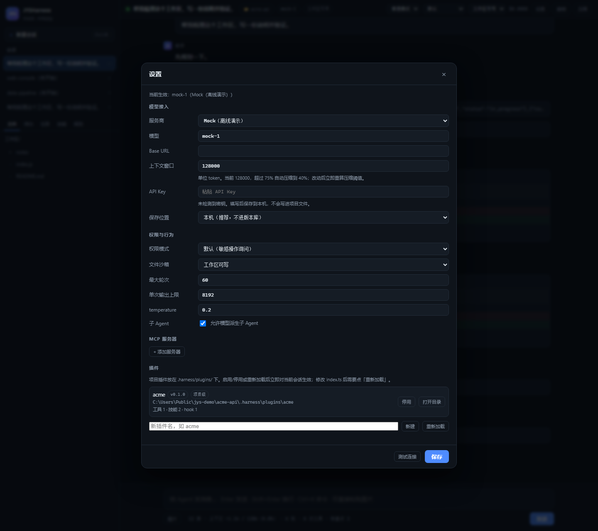

# 插件（Plugins）

插件是**项目级**的 JYSHarness 扩展：一个目录，一段 `activate(api)`，就能给你的项目加上专属工具、约定、hook 和技能。



## 和已有的扩展方式怎么分工

| 方式 | 形态 | 适合 |
| --- | --- | --- |
| **插件** | 目录 + `index.ts` | 需要**新增工具**、进程内 hook、组合多种扩展的项目工作流 |
| Skills | `SKILL.md` | 纯提示词的长流程说明，按需加载 |
| Hooks | settings.json 里的 shell 命令 | 跨项目通用、语言无关的拦截/审计 |
| MCP | 独立服务器进程 | 已经存在的外部服务（数据库、Jira、浏览器…） |

插件可以**同时**贡献工具、提示段落、hook 和技能，且不需要启动额外进程。

## 目录结构

```
<workspace>/.harness/plugins/<name>/
  plugin.json        # 清单
  index.ts           # 入口，导出 activate(api)
  skills/            # 可选：随插件分发的技能
    example/SKILL.md
```

用户级插件放在 `~/.jysharness/plugins/<name>/`（设了 `HARNESS_HOME` 就跟着走），对所有项目生效。

### plugin.json

```json
{
  "name": "acme",
  "version": "0.1.0",
  "description": "ACME 项目工作流",
  "entry": "index.ts",
  "skills": "skills",
  "enabled": true
}
```

- `entry` 省略时按 `index.ts` / `index.mjs` / `index.js` 顺序查找，且**必须在插件目录内**（`../` 会被拒绝）。
- `enabled: false` 保留插件但不加载（设置面板里也能一键停用）。
- 插件名只允许字母、数字、`.` `_` `-`。

## API

`activate(api)` 里的 `api`：

| API | 作用 |
| --- | --- |
| `api.registerTool(tool)` | 注册工具，接口与内置工具完全一致（`name/description/inputSchema/isReadOnly/isConcurrencySafe/call`） |
| `api.addPromptSection(text)` | 追加稳定的系统提示段落（项目约定） |
| `api.on(event, handler)` | 进程内 hook：`PreToolUse` `PostToolUse` `PostToolUseFailure` `PreCompact` `Stop` `UserPromptSubmit` `SessionStart`；payload 见下 |
| `api.addSkill({name, description, content})` | 内存技能，不进文件 |
| `api.log(message)` | 写日志（`--debug` 可见） |
| `api.name` / `api.version` / `api.workspaceRoot` | 元信息 |

**hook payload 的字段名（容易踩坑）：** 进程内 handler 和 shell 钩子的 stdin JSON 用的是**同一套 camelCase 字段**：

```jsonc
{ "event": "PreToolUse", "sessionId": "...", "cwd": "...",
  "toolName": "Write", "toolInput": { "file_path": "..." },
  "toolResult": "…",   // PostToolUse / PostToolUseFailure
  "prompt": "…" }      // UserPromptSubmit
```

是 `toolName` / `toolInput`，**不是** `tool_name` / `tool_input`。写错字段名的钩子不会报错，只会永远不匹配 —— 所以脚手架模板里直接给了可用写法。

hook handler 返回 `{ decision: "deny", reason }` 可以拦住工具调用，返回 `{ updatedInput }` 可以改参数，返回 `{ additionalContext }` 会给模型补一句话。

## 完整示例

```ts
export function activate(api) {
  // 1) 项目约定
  api.addPromptSection("<project_rules>使用 pnpm；提交前跑 pnpm lint 与 pnpm test。</project_rules>");

  // 2) 专属工具
  api.registerTool({
    name: "acme_deploy",
    description: "把当前分支部署到 staging，返回部署 URL。",
    inputSchema: { type: "object", properties: { branch: { type: "string" } } },
    isReadOnly: false,
    isConcurrencySafe: () => false,
    async call(input, ctx) {
      const { execFile } = await import("node:child_process");
      return await new Promise((resolve) => {
        execFile("npm", ["run", "deploy:staging"], { cwd: ctx.workspaceRoot }, (err, stdout) => {
          resolve({ content: err ? "部署失败：" + err.message : stdout, isError: Boolean(err) });
        });
      });
    },
  });

  // 3) 拦截危险操作（进程内，不用起 shell）
  api.on("PreToolUse", (payload) => {
    const target = String(payload.toolInput?.file_path ?? "");
    if (/migrations[\\/]/.test(target)) return { decision: "deny", reason: "不要直接改 migrations/" };
    return;
  });

  // 4) 技能
  api.addSkill({
    name: "acme-release",
    description: "ACME 发版流程",
    content: "# 发版\n1. bump 版本\n2. pnpm test\n3. 打 tag 并推送",
  });
}
```

## 桌面端管理

顶栏「设置」→「插件」：

- 列出项目级 + 用户级插件，含版本、贡献数量（工具/技能/hook）、路径
- **停用 / 启用**：直接改 `plugin.json` 的 `enabled`，立即生效
- **重新加载**：重读所有插件并热替换到每个会话（改完 `index.ts` 不用重启）
- **新建**：填名字点一下，等价于 `jys plugin new <name>`
- **打开目录**：在文件管理器里定位到插件
- 加载失败的插件会显示具体错误，不影响其它插件

## 插件开发模式

顶栏的「工作模式」下拉切到 **插件开发**（或 `jys --agent-mode makePlugin ...`）：

- 系统提示会注入插件 API 说明和开发流程（脚手架 → 写 `index.ts` → `jys plugin test` → 修到通过 → 重新加载）
- 模型会按这个流程工作，而不是随手写个文件了事
- 权限不变：仍然受权限模式、沙箱和规则约束

适合"让 Agent 帮我做一个项目专属插件"这种任务。

## 开发流程

```bash
jys plugin new acme                 # 在当前工作区生成脚手架
# 编辑 .harness/plugins/acme/index.ts
jys plugin test                     # 加载并校验：工具、技能、错误
jys plugin list                     # 列出全部插件及贡献数量
jys --agent-mode makePlugin         # 打开桌面端，进入插件开发模式
```

## 加载与隔离

- **每个插件独立加载**：JSON 写错、入口不存在、`activate` 抛异常都只会让**这一个**插件失败，其余照常工作。
- **重复工具名**会被拒绝并警告，不会覆盖内置工具。
- 插件在**进程启动时加载**；设置面板的「重新加载」会重新 import（用文件 mtime 破缓存），不需要重启。
- 新开会话（含切换工作区）会应用当前已加载的插件。

## 调试

- `jys plugin test` 失败返回非 0，适合放进 CI。
- `jys --debug serve` 能看到 `[plugin-name]` 前缀的日志。
- 插件工具和内置工具走同一套权限管道：在规则面板里写 `acme_deploy` 或 `acme_*` 就能约束它。

## 分发

插件是工作区的一部分（`.harness/plugins/`），跟着仓库走；也可以放到 `~/.jysharness/plugins/` 作为你自己的常用工具箱。

## 插件能配置到什么程度（实测）

下面这些都是**已经跑通并验证过**的，不是设计设想。

### 三种扩展形态

| 形态 | 放哪里 | 适合什么 | 隔离 |
| --- | --- | --- | --- |
| **项目插件** | `<workspace>/.harness/plugins/<name>/` | 只属于这个项目的工具/约定/hook | 同进程 |
| **用户插件** | `~/.jysharness/plugins/<name>/`（`HARNESS_HOME` 可改） | 跨项目通用（个人习惯、公司规范） | 同进程 |
| **MCP 服务器** | settings 里的 `mcpServers` | 进程外扩展、换语言、独立升级 | 独立进程 |

前两种是同一个 API（`activate(api)`），区别只是生效范围；第三种走 MCP 协议，工具名自动加 `mcp__<server>__` 前缀。

### 插件能拿到什么（`PluginApi`）

```ts
api.registerTool({...})        // 新工具，和内置工具走同一条 权限→审计 管道
api.on("PreToolUse", fn)       // 进程内 hook：可直接 deny 一次调用
api.addSkill({...})            // 内存技能（不落文件）
api.addPromptSection(text)     // 固定提示段落（每轮都在，适合放团队约定）
api.log(msg)                   // 打到 serve/desktop 控制台
```

外加清单里的 `skills: "skills/"` 可以随插件分发**文件技能**（每个 `*.md` 一个 `SKILL.md` 格式）。

### 实测：一个插件四件套全生效

写了一个 `team-conventions` 插件（工具 + hook + 内存技能 + 文件技能 + 提示段落），用真模型跑：

| 验证项 | 结果 |
| --- | --- |
| 加载 | `tools=1 skills=2 hooks=1`，`errors` 为空 |
| 工具被模型调用 | 模型主动调 `team_iso_now`，返回 `2026-11-17T18:06:09Z` |
| hook 拦截 | 让模型写 `secrets.env` → 插件返回 deny → **文件不存在** |
| 技能 | 内存技能 `changelog` + 文件技能 `release-note` 都进了技能索引 |
| 提示段落 | 进入系统提示，每轮都在 |

外部 MCP 也验证过：一个 30 行的 Node MCP server 暴露 `deploy_window`，被注册成 `mcp__team__deploy_window`，调用返回正确结果。

### 这次补上的一个安全缺口

**插件工具原来不走 `guardPath`**。插件自己没写 `toolCheck` 时，它能写工作区外——而内置 `Write` 不能。等于"沙箱承诺取决于第三方作者是否细心"。

修法：`ToolRegistry.assemble()` 对**所有扩展工具**（插件 + MCP）兜底注入路径校验：若 schema 里有 `file_path` / `path` / `target` 等路径参数且工具未自定义 `toolCheck`，就自动接上 `guardPath`（只读工具按 read 判、其余按 write 判）。

四条测试锁住：注入生效、插件自己的 `toolCheck` 不被覆盖、没有路径参数的工具不乱加、`bypassPermissions` 下插件越界写入仍被 deny。

### 仍然没有的（写插件前要知道）

| 缺口 | 影响 |
| --- | --- |
| **没有插件市场/安装命令** | 只能手动放进目录；`jys plugin list` 能看状态、能启用/禁用 |
| **同进程、无沙箱** | 插件代码直接跑在 harness 进程里，能 `import` 任意模块、能读环境变量。**只装你信任的插件** |
| **没有版本兼容声明** | manifest 的 `version` 只是展示，不校验平台兼容性 |
| **没有权限清单** | 插件不需要声明"我要读网络/写文件"，装上就拥有进程的全部能力 |
| **MCP 走子进程但仍然全权** | 工具调用本身受权限管道约束，但 server 进程自身不受沙箱限制 |


## 与 DSH 的兼容性（实测）

结论：**技能天然兼容（已跑通），MCP 通用，DSH 的前端客户端插件不兼容。**

### 技能：直接可用（不是"能转换"，是"能读"）

DSH 的技能格式是**扁平 `*.md` + frontmatter**：

```yaml
---
name: active-scan
description: 主动端口与服务扫描（nmap/masscan），严格遵守授权范围
whenToUse: 需要确认资产存活与开放端口时
role: recon
enabled: true
---
## 前置检查
...
```

JYSHarness 的技能发现本来就认扁平 `.md`，所以两个格式在文件层面就是同一件事。差别只在 frontmatter 的两个字段：

| 字段 | 之前 | 现在 |
| --- | --- | --- |
| `whenToUse` | 被忽略（可 DSH 的 23 个技能**全部**写了它） | 解析并**并入 description**：`主动端口与服务扫描（何时使用：需要确认资产存活…）` |
| `enabled: false` | 被忽略（停用的技能照样加载） | **跳过**并提示"已停用" |
| `role` | 忽略 | 忽略（仅分类信息，对行为无影响） |

### 导入命令

```bash
jys skill import-dsh "~/.dsh/redteam/skills" --to project   # 进当前项目
jys skill import-dsh <dir> --to user                        # 进用户级（所有项目）
jys skill list                                              # 看当前可见的技能
```

实测：把 DSH 真实目录 `~/.dsh/redteam/skills` 的 **23 个技能**导入临时工作区 → `复制 23 个` → `skill list` 全部可见、`whenToUse` 已并入描述；再导一次是 `复制 0 个，跳过 23 个`（幂等，不覆盖用户改过的版本）。

### MCP：同一份配置两边都能用

JYSHarness 的 `mcpServers` 就是标准 MCP 配置（`command` + `args` + `env`），与 DSH/Claude 一侧的写法一致。实测用 30 行的 Node MCP server 验证过：工具注册为 `mcp__<server>__<tool>`，调用返回正确结果。所以基于 MCP 的扩展两边通用。

### 不兼容的部分（要说清）

| DSH 侧 | 能否复用 | 原因 |
| --- | --- | --- |
| **客户端插件（client-plugin）** | ❌ | DSH 的前端插件是打进 `apps/web` 的 React/TS 包，走 HMR 注入 `window.__DSH_BOOT__`；JYSHarness 的 UI 是无构建的经典脚本，两套渲染模型不同 |
| **DSH 的 `activate(api)` 插件** | ⚠️ 需改写 | 两个平台的 `PluginApi` 不是同一个接口。工具/hook/技能的**贡献类型**一样，但对象形状不同（JYSHarness 是 `registerTool/addSkill/on/addPromptSection`）。好在单个插件通常只有几十行，改写成本低 |
| **DSH 的 session/checkpoint 数据** | ❌ | JSONL 结构不同 |
| **prompt-inject.md 之类的注入文件** | ⚠️ 需手写 | JYSHarness 对应的是 `.harness/memory.md` 与 `AGENTS.md` |

### 一句话总结

- **技能**：同一格式，`jys skill import-dsh` 一条命令搬过来，还能吃 `whenToUse` 和 `enabled`；
- **MCP**：同一协议，配置可直接复用；
- **插件代码**：贡献类型相同但接口不同，需要改写（通常几十行）；
- **前端插件**：不兼容，属于两套 UI。


## v2：从"钩进管线"到"可安装的能力面"

参考 [deepseek-ai/deepseek-harness](https://github.com/deepseek-ai/deepseek-harness)（"Everything is a Plugin"）。DSH 的插件是 Cordis 插件：每个能力都是一个把服务注册到 ctx 的包，分 host 半与 client 半，另有 Plugin Manager 负责安装/启停/检查。

JYSHarness 的 v1 只能"钩进已有管线"（工具/hook/技能/提示词）。v2 让插件能贡献**新的能力面**，因此一个插件可以是一个"可安装的服务 + 界面模块"。

### 对照表

| 能力 | DSH（Cordis） | JYSHarness v2 |
| --- | --- | --- |
| 注册工具 | `ctx.tools` | `api.registerTool()` |
| 注册服务/路由 | `ctx.<service>`，host 半持有 | `api.registerRoute()` → `/plugin/<id>/<path>` |
| UI 模块 | client 半包，编译进 client program | `ui/index.js`，宿主 `import()` 后 `mount(el, api)` |
| 命令 | `ctx.commands` | `api.registerCommand()` |
| 声明式清单 | package.json + Cordis 元信息 | `plugin.json`（id/engines/contributes/panels/ui） |
| 安装/启停 | Plugin Manager | `jys plugin list/enable/disable` + `/api/plugins` |
| 隔离 | host/client 双半 + 沙箱 runner | 同进程；路径守卫 + 目录包含校验 |

### 插件能贡献的五类东西

```json
{
  "name": "demo-panel", "id": "demo-panel", "version": "1.0.0",
  "entry": "index.ts", "ui": "ui",
  "engines": { "harness": ">=0.2" },
  "contributes": { "permissions": ["http-route", "ui-panel"] },
  "panels": [{ "id": "demo", "title": "演示面板", "icon": "◈", "slot": "sidebar" }]
}
```

```ts
export function activate(api) {
  api.registerTool({...});                                       // 工具（走权限/审计管道）
  api.on("PreToolUse", fn);                                      // 钩子（可 deny）
  api.addSkill({ name, description, content });                   // 内存技能
  api.addPromptSection("...");                                   // 固定提示段落
  api.registerRoute({ method: "GET", path: "stats", handler });    // HTTP 路由
  api.registerPanel({ id: "demo", title: "演示面板" });            // Web UI 面板
  api.registerCommand({ name: "/demo-ping", run });               // 斜杠命令
}
```

### 三条挂载路径

| 路径 | 来源 | 说明 |
| --- | --- | --- |
| `/plugin/<id>/<path>` | `api.registerRoute()` | 插件自己的 API；body 已解析 JSON、query 已解析 |
| `/plugin-assets/<id>/<file>` | 清单 `ui` 目录 | 浏览器侧资产，no-store 不缓存（改完刷新即生效） |
| `/api/config` 的 `panels` | 清单 `panels` | UI 首屏据此加侧栏按钮（同步读清单，不执行 activate） |

### 为什么面板要在清单里声明

`api.registerPanel()` 写在 `activate()` 里，而它是异步、可能有副作用；但 `/api/config` 是同步构造的（UI 首屏就要按钮）。所以：

- 清单 `panels` → 首屏可见（同步读 JSON）；
- `api.registerPanel()` → 运行期登记，出现在 `/api/plugins` 的贡献清单（调试/审计）。

### 安全边界（v2 新增两条）

| 风险 | 处理 |
| --- | --- |
| 插件资产被用来读任意文件 | `resolveAssetPath()` 做目录包含校验；`..` 穿越一律 404，且不区分"越界"与"不存在" |
| 插件工具绕过沙箱 | `ToolRegistry.assemble()` 对扩展工具兜底注入 `guardPath`（漏写 toolCheck 也拦得住） |
| 插件 JS 拥有页面权限 | 不做隔离，属于已知取舍：面板要与会话状态互通。只装信任的插件 |

### 实测（真实浏览器，非模拟）

| 验证项 | 结果 |
| --- | --- |
| `/api/config` 带上 panels | `[{id:"demo",title:"演示面板",icon:"◈",asset:"/plugin-assets/demo-panel/index.js"}]` |
| `GET /plugin/demo-panel/stats` | `{"plugin":"demo-panel","workspace":"…","at":"…"}` |
| `GET /plugin-assets/demo-panel/index.js` | 200 text/javascript（未开缓存） |
| `GET /plugin-assets/demo-panel/../../etc/passwd` | **404**（目录穿越被拒） |
| 不存在的插件路由 | **404** |
| 浏览器侧栏按钮 | 出现「◈ 演示面板」 |
| 点击后面板内容 | `插件: demo-panel / 工作区: … / 时间: …`（数据来自插件自己的路由） |
| 控制台异常 | 0 |

### 与 DSH 仍有的差距

| 差距 | 说明 |
| --- | --- |
| 无沙箱 runner | DSH 用 cordis-host-runner 把插件放进沙箱执行；这里插件在同进程，拥有进程全部能力 |
| 无动态安装 | DSH 有 Plugin Manager 安装持久化插件；这里是"放目录 + 启停"，没有从 URL/包仓库安装 |
| UI 能力有限 | 目前只有侧栏面板一个 slot；DSH 的 client 半可注册任意 slot/命令面板/设置页 |
| 无版本解析 | `engines` 只是声明，不校验；也没有插件间依赖解析 |

