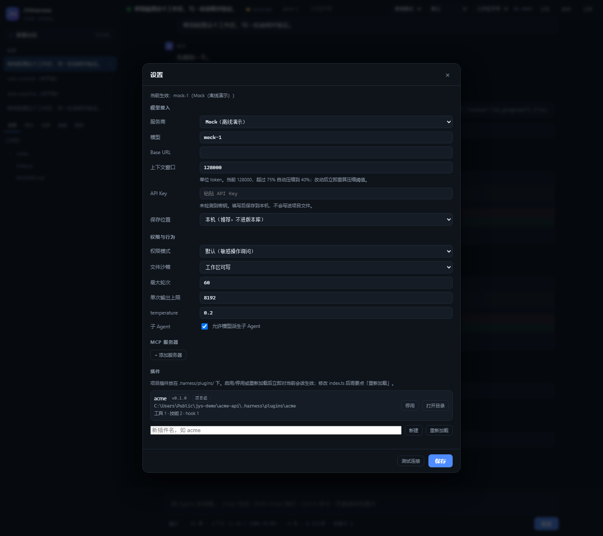

# 插件（Plugins）

插件是**项目级**的 JYSHarness 扩展：一个目录，一段 `activate(api)`，就能给你的项目加上专属工具、约定、hook 和技能。



## 和已有的扩展方式怎么分工

| 方式 | 形态 | 适合 |
| --- | --- | --- |
| **插件** | 目录 + `index.ts` | 需要**新增工具**、进程内 hook、组合多种扩展的项目工作流 |
| Skills | `SKILL.md` | 纯提示词的长流程说明，按需加载 |
| Hooks | settings.json 里的 shell 命令 | 跨项目通用、语言无关的拦截/审计 |
| MCP | 独立服务器进程 | 已经存在的外部服务（数据库、Jira、浏览器…） |

插件可以**同时**贡献工具、提示段落、hook 和技能，且不需要启动额外进程。

## 目录结构

```
<workspace>/.harness/plugins/<name>/
  plugin.json        # 清单
  index.ts           # 入口，导出 activate(api)
  skills/            # 可选：随插件分发的技能
    example/SKILL.md
```

用户级插件放在 `~/.jysharness/plugins/<name>/`（设了 `HARNESS_HOME` 就跟着走），对所有项目生效。

### plugin.json

```json
{
  "name": "acme",
  "version": "0.1.0",
  "description": "ACME 项目工作流",
  "entry": "index.ts",
  "skills": "skills",
  "enabled": true
}
```

- `entry` 省略时按 `index.ts` / `index.mjs` / `index.js` 顺序查找，且**必须在插件目录内**（`../` 会被拒绝）。
- `enabled: false` 保留插件但不加载（设置面板里也能一键停用）。
- 插件名只允许字母、数字、`.` `_` `-`。

## API

`activate(api)` 里的 `api`：

| API | 作用 |
| --- | --- |
| `api.registerTool(tool)` | 注册工具，接口与内置工具完全一致（`name/description/inputSchema/isReadOnly/isConcurrencySafe/call`） |
| `api.addPromptSection(text)` | 追加稳定的系统提示段落（项目约定） |
| `api.on(event, handler)` | 进程内 hook：`PreToolUse` `PostToolUse` `PostToolUseFailure` `PreCompact` `Stop` `UserPromptSubmit` `SessionStart`；payload 见下 |
| `api.addSkill({name, description, content})` | 内存技能，不进文件 |
| `api.log(message)` | 写日志（`--debug` 可见） |
| `api.name` / `api.version` / `api.workspaceRoot` | 元信息 |

**hook payload 的字段名（容易踩坑）：** 进程内 handler 和 shell 钩子的 stdin JSON 用的是**同一套 camelCase 字段**：

```jsonc
{ "event": "PreToolUse", "sessionId": "...", "cwd": "...",
  "toolName": "Write", "toolInput": { "file_path": "..." },
  "toolResult": "…",   // PostToolUse / PostToolUseFailure
  "prompt": "…" }      // UserPromptSubmit
```

是 `toolName` / `toolInput`，**不是** `tool_name` / `tool_input`。写错字段名的钩子不会报错，只会永远不匹配 —— 所以脚手架模板里直接给了可用写法。

hook handler 返回 `{ decision: "deny", reason }` 可以拦住工具调用，返回 `{ updatedInput }` 可以改参数，返回 `{ additionalContext }` 会给模型补一句话。

## 完整示例

```ts
export function activate(api) {
  // 1) 项目约定
  api.addPromptSection("<project_rules>使用 pnpm；提交前跑 pnpm lint 与 pnpm test。</project_rules>");

  // 2) 专属工具
  api.registerTool({
    name: "acme_deploy",
    description: "把当前分支部署到 staging，返回部署 URL。",
    inputSchema: { type: "object", properties: { branch: { type: "string" } } },
    isReadOnly: false,
    isConcurrencySafe: () => false,
    async call(input, ctx) {
      const { execFile } = await import("node:child_process");
      return await new Promise((resolve) => {
        execFile("npm", ["run", "deploy:staging"], { cwd: ctx.workspaceRoot }, (err, stdout) => {
          resolve({ content: err ? "部署失败：" + err.message : stdout, isError: Boolean(err) });
        });
      });
    },
  });

  // 3) 拦截危险操作（进程内，不用起 shell）
  api.on("PreToolUse", (payload) => {
    const target = String(payload.toolInput?.file_path ?? "");
    if (/migrations[\\/]/.test(target)) return { decision: "deny", reason: "不要直接改 migrations/" };
    return;
  });

  // 4) 技能
  api.addSkill({
    name: "acme-release",
    description: "ACME 发版流程",
    content: "# 发版\n1. bump 版本\n2. pnpm test\n3. 打 tag 并推送",
  });
}
```

## 桌面端管理

顶栏「设置」→「插件」：

- 列出项目级 + 用户级插件，含版本、贡献数量（工具/技能/hook）、路径
- **停用 / 启用**：直接改 `plugin.json` 的 `enabled`，立即生效
- **重新加载**：重读所有插件并热替换到每个会话（改完 `index.ts` 不用重启）
- **新建**：填名字点一下，等价于 `jys plugin new <name>`
- **打开目录**：在文件管理器里定位到插件
- 加载失败的插件会显示具体错误，不影响其它插件

## 插件开发模式

顶栏的「工作模式」下拉切到 **插件开发**（或 `jys --agent-mode makePlugin ...`）：

- 系统提示会注入插件 API 说明和开发流程（脚手架 → 写 `index.ts` → `jys plugin test` → 修到通过 → 重新加载）
- 模型会按这个流程工作，而不是随手写个文件了事
- 权限不变：仍然受权限模式、沙箱和规则约束

适合"让 Agent 帮我做一个项目专属插件"这种任务。

## 开发流程

```bash
jys plugin new acme                 # 在当前工作区生成脚手架
# 编辑 .harness/plugins/acme/index.ts
jys plugin test                     # 加载并校验：工具、技能、错误
jys plugin list                     # 列出全部插件及贡献数量
jys --agent-mode makePlugin         # 打开桌面端，进入插件开发模式
```

## 加载与隔离

- **每个插件独立加载**：JSON 写错、入口不存在、`activate` 抛异常都只会让**这一个**插件失败，其余照常工作。
- **重复工具名**会被拒绝并警告，不会覆盖内置工具。
- 插件在**进程启动时加载**；设置面板的「重新加载」会重新 import（用文件 mtime 破缓存），不需要重启。
- 新开会话（含切换工作区）会应用当前已加载的插件。

## 调试

- `jys plugin test` 失败返回非 0，适合放进 CI。
- `jys --debug serve` 能看到 `[plugin-name]` 前缀的日志。
- 插件工具和内置工具走同一套权限管道：在规则面板里写 `acme_deploy` 或 `acme_*` 就能约束它。

## 分发

插件是工作区的一部分（`.harness/plugins/`），跟着仓库走；也可以放到 `~/.jysharness/plugins/` 作为你自己的常用工具箱。
