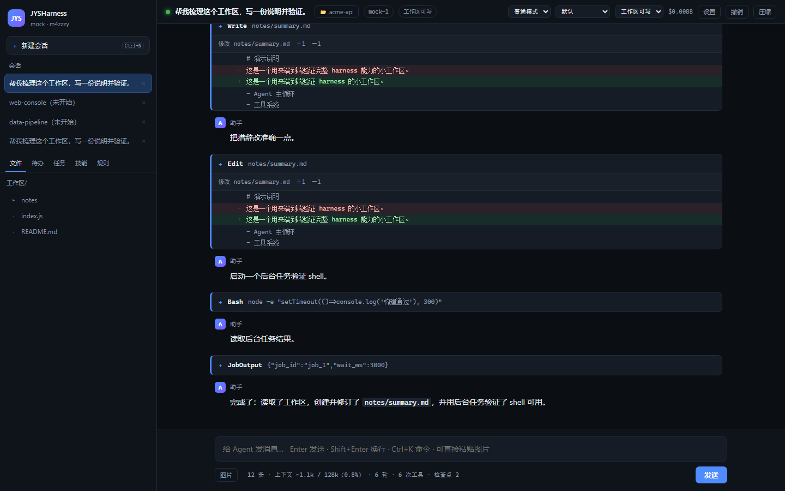
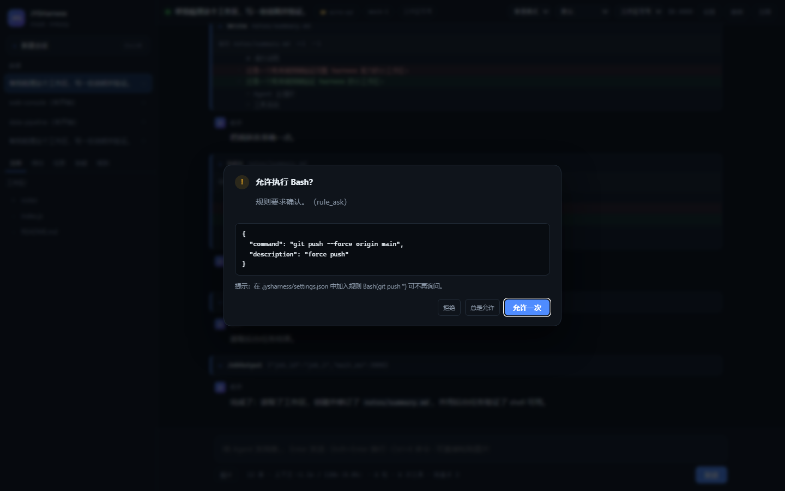
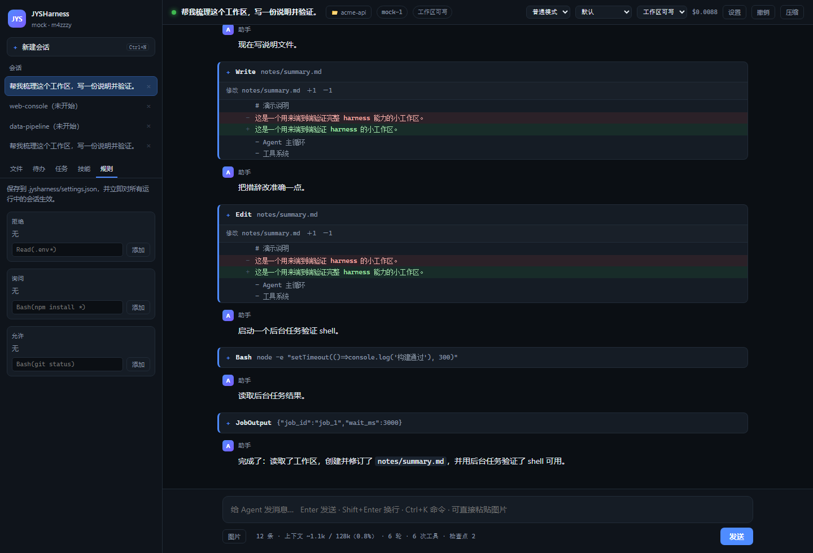
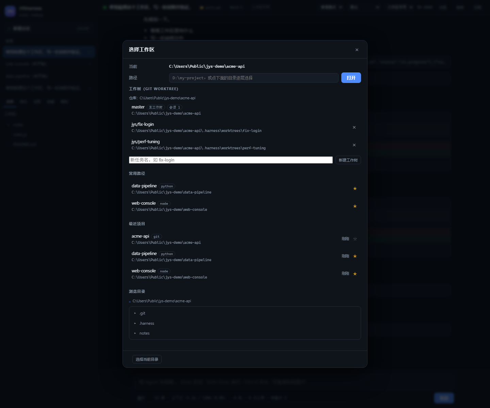
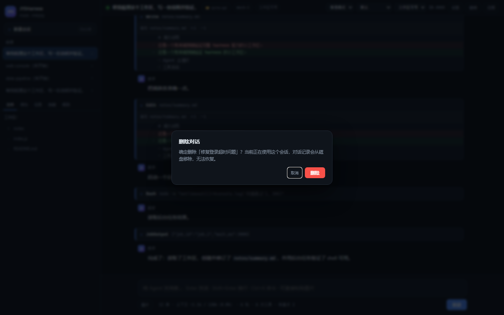

# JYSHarness

一个从零实现的 AI Agent Harness —— 参考 [《Harness Engineering: 基于 Claude Code 的完全指南》](https://wanlanglin.github.io/-awesome-cc-harness/zh/)，用 TypeScript 实现 Claude Code / DeepSeek Harness 的核心设计，并做成可用的桌面产品。

**零运行时依赖**：只用 Node 内置模块，Node 24 直接运行 .ts，不需要 npm install。

> 开发期有 **两个** devDependency（`typescript` + `@types/node`）用于类型检查 —— 发布包里不含 `node_modules`，
> 用户侧仍然是"双击即用、无需安装"。开发者只需 `npm install && npm run typecheck`。

```
模型（LLM）是那匹马，harness 是围栏、缰绳和跑道。
```



---

## 30 秒上手（不需要 API Key）

```bash
cd harness

# 桌面窗口（Edge/Chrome app 模式，无边框、独立 profile）
node src/cli/main.ts desktop --provider mock --script examples/mock-scenario.json \
    --workspace examples/demo-workspace -y

# 或者只起服务，浏览器打开 http://127.0.0.1:4317
node src/cli/main.ts serve --workspace examples/demo-workspace

# 终端交互（同样的内核）
node src/cli/main.ts
```

Windows 上可以直接双击 `jys.cmd`：不带参数时打开桌面端，工作区默认 `%USERPROFILE%\jysharness-workspace`；终端模式用 `jys repl`。

接真实模型：

```bash
export ANTHROPIC_API_KEY=sk-ant-...      # node src/cli/main.ts
export DEEPSEEK_API_KEY=sk-...           # node src/cli/main.ts --provider deepseek --model deepseek-chat
node src/cli/main.ts --provider openai --model qwen2.5-coder --workspace /path/to/repo
```

## 安装为桌面应用

```powershell
cd harness
.\scripts\install-desktop.ps1            # 在桌面创建 JYSHarness 快捷方式
.\scripts\install-desktop.ps1 -Workspace D:\work   # 指定默认工作区
```

快捷方式执行 `jys desktop --workspace <ws>`，双击即开窗口；首次运行会自动创建 workspace 目录。

## 能力清单

| 能力 | 说明 |
| --- | --- |
| **Agent Loop** | Async Generator + continue 站点：413 反应式压缩、max_tokens 升上限+续写、429/5xx 退避、空回复重试、Stop Hook 阻断 |
| **备用模型** | `fallbackModel`：主模型认证失败/限流耗尽/5xx 时切一次（同一 provider 内换模型），切换有提示、不来回横跳 |
| **错误恢复** | 遵循服务端 `Retry-After`；网络抖动（ECONNRESET/超时）按瞬时错误重试并带抖动；其余每个失败都有明确终止原因：`max_output_tokens`（续写耗尽，不再假装成功）、`stop_hook_prevented`（钩子连续拦 3 次）、`prompt_too_long`、`model_error`（认证失败附带可操作提示） |
| **工具系统** | 14 个内置工具 + MCP 动态工具；Schema 校验 → 权限 → Hook → 执行 → 事后审计 |
| **输出治理** | 单次输出上限（默认 50k 字符，Bash 30k / WebFetch 60k），截断保头也保尾并标明省略量；单工具超时（WebFetch 30s、MCP 120s） |
| **工具调度** | 只读批量并行（**并发上限 6**）、**同批相同调用去重**、**只读工具失败自动重试 1 次**（写操作永不重试）；按工具统计调用/失败数 |
| **熔断与恢复** | 同一工具连续失败 3 次 → 短路 60s 并在错误里说明"别重试，换办法"；MCP server 崩溃后**自动重启并重试一次** |
| **读缓存** | Read 按「路径 + 窗口 + mtime + size」缓存，改文件即失效，LRU 上限 32 项 / 8MB |
| **并发编排** | 只读工具并行、写入工具串行；审批与 Hook 在分区之前串行完成 |
| **权限模型** | 6 段管道（硬编码拒绝 → deny → ask → 工具自检 → allow → 模式），每条决策带 reason |
| **安全边界** | 允许规则必须覆盖**整条**命令（含 `$(...)`、反引号、`bash -c` 的内联脚本，防 `git status $(rm -rf x)` 洗白）；deny/ask 同样逐段生效；毁灭性命令（含 Windows 原生）硬拒绝不可覆盖 |
| **文件写保护** | **硬编码拒绝**（不依赖配置）：`.git`、`node_modules`、`.harness/settings.json`、`.harness/skills`、`.harness/sessions`、`.jysharness/settings*.json` —— 文件工具由 `guardPath` 拦，**shell 由内核完整性级别拦**；`AGENTS.md`、`CLAUDE.md`、`.harness/plugins/**` 需确认 |
| **SSRF 防护** | 字面黑名单 + **DNS 解析后 IP 校验** + **重定向逐跳校验**（最多 3 跳）；provider 密钥永不下发子进程 |
| **Auto 模式** | 命令风险分类器：只读命令免询问，未知/写操作/解释器一律升到 ask；deny 规则永远优先 |
| **配置层级** | 用户全局 < 项目共享 < 项目本地 < CLI < 机器策略（`ProgramData\jysharness\settings.json`），机器策略可钉死本地 flag |
| **沙箱** | 真实路径包含检查（`..`/符号链接/Windows 8.3 短路径）、只读模式双处拦截 |
| **多会话** | 新建 / 切换 / **fork** / 删除，每个会话独立的循环、审批队列、后台任务 |
| **崩溃安全** | JSONL 追加写 + **串行化**（并发 append 不会写坏行）；轮次结束时 flush，`send()` 返回即已落盘；半行/坏行在恢复时跳过；**写盘失败只告警不杀轮次**；压缩检查点取代前缀 |
| **MCP** | stdio JSON-RPC 客户端：initialize → **分页 tools/list** → tools/call；工具以 `mcp__server__tool` 注册；UTF-8 用 `StringDecoder` 跨分帧解码；每调用超时可配（默认 120s）；单行缓冲 8MB 上限；崩溃自动重启 |
| **Skills** | `.harness/skills/*/SKILL.md` 按需加载：系统提示只放名字+描述，正文调用时才进上下文 |
| **后台任务** | `Bash run_in_background` + `JobOutput/JobKill/JobList`，长任务不阻塞循环 |
| **待办** | `TodoWrite` 工具 + 侧栏实时面板 |
| **检查点/撤销** | 每次写文件前快照，`undo` 回滚；UI 内联显示真实 diff |
| **上下文压缩** | 三级：microcompact → LLM 摘要（只压老前缀，尾部原样保留）→ snip 兜底；压缩写检查点，resume 不重摘 |
| **子 Agent 类型** | 内置 `explore`（只有 Read/Grep/Glob）/ `plan` / `general`；项目可在 `.harness/agents/*.md` 用 frontmatter 声明 `tools` / `model` / `maxTurns` / 专用提示 —— **工具集就是能力边界**，不是靠提示词自觉 |
| **并发编排** | 同一条消息里的多个 `Agent` 调用**并行执行**；检查点按异步上下文分帧（并发写不互相覆盖）、待办各自独立、单个子 Agent 失败不影响兄弟（并如实标记 `isError`） |
| **子 Agent 进度** | 运行中通过旁路事件实时上报（启动 / 第 N 步执行了什么工具 / 结束），CLI 逐行打印、桌面端原地更新一行，不必等整轮结束 |
| **子 Agent** | 从**空消息列表**起步、独立轮次预算、只回传**截断后**的摘要；权限/Hook/沙箱完全继承（不提权）；**父 abort 连带取消** + 独立硬超时；token 按增量计入统计；**审批弹窗标注"子 Agent 发起"**；可用 `subagentModel` 指定更便宜的模型 |
| **Hooks** | 7 个事件（SessionStart / UserPromptSubmit / PreToolUse / PostToolUse / PostToolUseFailure / PreCompact / Stop），**配置在 settings.json 里（数据驱动，不改代码）**；可阻断、可改参数、可加注；支持 `async` 旁路钩子；配置写错只告警不崩 |
| **Hooks 语义** | 多钩子按 **deny > ask > allow** 合并（后写的 allow 不能取消前面的 deny）；matcher 编译失败只影响该条；超时夹在 0.1–60s |
| **成本核算** | 按模型定价估算 USD，顶栏实时显示 |
| **WebFetch** | 抓取网页转文本，阻断 loopback/私网地址（SSRF） |
| **图片输入** | 粘贴/选择图片，base64 走 Anthropic image block 或 OpenAI image_url |
| **沙箱后端** | 子进程环境清洗 + **Windows 低完整性令牌 + Job Object**（内核强制：写隔离 + 内存/进程上限）/ Linux bwrap / macOS seatbelt |
| **强制可见性** | 顶栏显示「⚠ 沙箱未强制」：模式是意图，`sandboxEnforcement` 报告实际后端；沙箱不可用时绝不假装有内核保护 |
| **规则编辑器** | 侧栏直接增删 allow/deny/ask 规则，写回 settings.json 并立即对所有会话生效 |
| **桌面安装器** | 一条命令在桌面创建快捷方式，双击即开 |
| **插件模式** | `.harness/plugins/` 下的项目插件：注册专属工具、进程内 hook、提示段落与内存技能；坏插件只隔离不致命，entry 不能逃出插件目录；**与内置工具重名会被报告**（不是静默丢弃） |
| **技能索引预算** | 系统提示只列**最多 40 个**技能（简介截断 140 字），其余折叠一行；未列出的技能仍可按精确名字加载 —— 索引是每轮固定成本，必须封顶 |
| **思考过程** | 推理模型（deepseek-flash / r1 / Anthropic thinking）的推理流以折叠块展示，默认收起、显示字数；**不发回模型、不计入上下文**，但保留在转录里（刷新后仍在） |
| **真模型验证** | 已用 DeepSeek 兼容端点（`deepseek-flash`）跑通：`HARNESS_E2E_REAL=1 npm run e2e` **24/24**；桌面端 4 秒完成 Write→Read，成本 $0.0021、缓存命中 39% |
| **响应式布局** | 桌面窗口可任意缩放（Chromium app 模式，尺寸由 profile 记住）；≤1280 隐藏冗余标签、≤920 侧栏收窄、≤768 侧栏变 ☰ 抽屉、≤560 控件紧凑 |
| **项目快捷入口** | 常用路径（★ 固定）+ 最近项目（含类型徽标与相对时间），空会话上一键直达 |
| **项目约定注入** | 从仓库根到当前目录逐级读取 `AGENTS.md`/`CLAUDE.md`（总预算 32k 字符）；**系统提示每轮重建**，改完当轮生效 |
| **提示词稳定性** | 系统提示**只放整个会话不变的内容**；日期与 git 状态作为临时后缀拼在最新一条消息上（不落盘），因此 git 变化**不会打断缓存前缀** |
| **精确计数** | 接近阈值时调用服务商的 `count_tokens`（Anthropic 官方端点）拿到**真实** token 数；`HARNESS_COUNT_TOKENS=off` 可关闭；失败自动回退估算 |
| **估算校准** | 用服务端回报的真实 `inputTokens`（以及精确计数）校准本地估算（EMA，夹在 0.5–2×），压缩阈值按校准后的值判断 |
| **记忆系统** | `.harness/memory.md` 跨会话事实，`Memory` 工具增删，注入系统提示（8k 字符上限，超了淘汰最旧） |
| **端到端验收** | `npm run e2e`：一次真实任务串起工具/权限/沙箱/插件/技能/MCP/子 Agent/压缩/恢复/撤销/服务端冒烟，**24 项断言**；`HARNESS_E2E_REAL=1` 可换成真模型（无 Key 时明确跳过，exit 2） |
| **约束检查** | `jys check`：import 解析、分层许可、零依赖、文档链接、密钥扫描；`--entropy` 加大文件 / TODO / 版本漂移 / 测试数量漂移 / **死导出**；`--types` 加 **TypeScript 严格类型检查**；`--install-hook` 挂 pre-commit |
| **类型闸门** | `npm run typecheck`（`tsc --strict`，**src + tests + scripts 零错误**）；`erasableSyntaxOnly` 提前拦住 Node 剥离模式跑不起来的写法（enum / 参数属性 / namespace）；`src` 里 **0 处 `as any`** |

## 工具（14 个 + MCP）

| 工具 | 作用 | 只读 |
| --- | --- | --- |
| `Read` `Write` `Edit` | 文件读写；Edit 要求唯一匹配，写前自动快照 | 混合 |
| `Glob` `Grep` | 找文件、搜内容 | ✅ |
| `Bash` | 平台 shell（pwsh→powershell 降级），可后台运行 | ❌ |
| `Agent` | 派生子 Agent | ❌ |
| `TodoWrite` | 维护任务清单 | ❌ |
| `JobOutput` `JobKill` `JobList` | 后台任务读取/终止/列表 | ✅/❌ |
| `WebFetch` | 抓网页 | ✅ |
| `Skill` | 加载技能正文 | ✅ |
| `mcp__<server>__<tool>` | 任意 MCP 工具，启动时自动发现 | 由 `readOnlyHint` 决定 |

## 界面

| 区域 | 内容 |
| --- | --- |
| 左栏 | 会话列表（新建 / 切换 / fork / 删除，删除有二次确认）、Files / Todos / Jobs / Skills / Rules 五个面板 |
| 顶栏 | 标题、模型、沙箱、权限模式、成本、undo、compact |
| 主区 | 流式对话、工具卡片（点击展开，文件改动直接内联 diff） |
| 抽屉 | 点击文件名/文件树，右侧查看源码 |
| 命令面板 | `Ctrl+K`：所有命令，含模式与沙箱切换 |
| 权限弹窗 | Allow once / Always allow / Deny，带规则建议 |



规则可以直接在左栏 Rules 面板增删，保存即写回 `.jysharness/settings.json` 并热更新所有会话：



界面文案全部为中文。可翻译的字符串集中在 `src/server/ui/app.js` 顶部的标签表（权限行为、沙箱、任务状态、停止原因、命令面板）与服务端 `notice` 事件的 `code` 映射里，加英文版只需补一张表。

> 说明：CLI（`jys` 终端模式）与工具返回值仍为英文——工具返回值是给模型读的协议内容，不属于界面文案。

## 在界面里切换工作区

顶栏的 📁 按钮打开工作区选择器：

- **当前**：正在操作的项目目录
- **直接输入**：粘贴任意路径，回车或点「打开」
- **常用路径**：手动 ★ 固定的入口，最多 12 个，不受"最近"淘汰影响
- **最近项目**：按打开时间倒序自动记录 8 个，显示项目类型（git / node / python）和「刚刚 / 3 小时前」
- **浏览目录**：从盘符逐层点进去，「选择当前目录」确认

空会话的界面上还有一排**快捷入口**（当前工作区除外，常用路径优先），一次点击直接切过去。
两条列表都存在 `~/.jysharness/settings.json`（`favoriteWorkspaces` / `recentWorkspaces`），不进项目；目录被删掉后不会再出现在最近列表里。

切换会**新建一个绑定该目录的会话**（之前的工作区会话保留，可随时切回）；同一个目录再次打开会复用已有会话，不会重复创建。工作区决定了 Agent 能读写的边界 —— 沙箱的 `workspace-write` 就是相对它生效的。



## 删除对话

左栏会话行右侧有 **×**，点击弹出二次确认（显示会话标题，当前会话会额外提示），确认后：

- 从会话列表移除，**同时删除磁盘上的 `.harness/sessions/<id>.jsonl`** 和它的 transcript 备份
- 正在运行的会话会被中断，后台任务一并终止
- 历史会话（只存在于磁盘、当前进程没加载的）也可以删
- 只剩一个会话时不允许删除（避免没有可用工作区）



## 在界面里配置模型

顶栏「设置」打开配置面板，不需要改文件、不需要重启：

| 区块 | 内容 |
| --- | --- |
| 模型接入 | 服务商（Anthropic / OpenAI / DeepSeek / 兼容端点 / Mock）、模型、Base URL、API Key、保存位置 |
| 权限与行为 | 权限模式、文件沙箱、最大轮次、单次输出上限、temperature、是否允许子 Agent |
| MCP 服务器 | 增删服务器，保存后立即重连，无需重启 |

保存后**当场热切换**：所有运行中的会话立刻使用新模型，系统提示里的模型名同步更新。
「测试连接」会真的发一次最小请求，返回耗时或具体错误。

**上下文窗口**：设置面板里可以直接填「上下文窗口」（token）。填 0 或留空表示按模型名自动推断（claude→200k、gpt-4.1→1M、deepseek/qwen→128k、llama→32k、其它→128k）。

窗口决定压缩阈值：**超过 75% 自动压缩，目标压到 40%**（200k 窗口 → 150k 触发 / 80k 目标；8k 小模型 → 6k 触发 / 3.2k 目标）。界面底部实时显示 `上下文 ~1.0k / 128k（0.8%）`。

压缩顺序是 **microcompact（削老工具输出）→ LLM 摘要（只压老前缀，最近几条和首条任务原样保留）→ snip（摘要不可用时的兜底）**。摘要会写成 transcript 里的 `compact` 检查点，resume 时直接用压缩后的视图，不会把上百 k 的历史重新摘一遍。

也可以手动触发：`/compact`，或带上关注点 `/compact 保留 API 签名改动`，和 Claude Code 的用法一致。输入框上方的「压缩」按钮等价于 `/compact`。

**密钥怎么存**：API Key 只写入 `~/.jysharness/secrets.json`（权限 600），**不会**写进项目里的 settings.json，接口也永远不回传明文（只回 `sk-m…3456` 这样的提示）。要便携/隔离，可以设 `HARNESS_HOME` 换配置目录。


## 项目插件（Plugin 模式）

给某个项目加专属能力，不用改 harness 源码：

```bash
jys plugin new acme            # 在 .harness/plugins/acme/ 生成脚手架
# 编辑 index.ts：注册工具 / hook / 技能 / 提示段落
jys plugin test                # 加载校验，出错返回非 0
```

插件是一个目录：`plugin.json` + `index.ts`，入口导出 `activate(api)`：

| API | 作用 |
| --- | --- |
| `registerTool` | 新增工具，与内置工具走同一套权限/并发/diff 管道 |
| `addPromptSection` | 追加项目约定到系统提示 |
| `on(event, handler)` | 进程内 hook（PreToolUse 等），无需起 shell |
| `addSkill` | 内存技能，按需加载 |

加载是**逐插件隔离**的：坏掉的插件只影响自己，其余照常工作。完整 API、示例和调试方式见 [PLUGINS.md](./PLUGINS.md)。

## 多任务并行（git worktree）

同一个仓库要同时干几件事，最干净的做法是**每个任务一个 worktree**：


顶栏 📁 → 「工作树」区块：

| 元素 | 说明 |
| --- | --- |
| 列表 | 仓库下所有 worktree：分支名、路径、是否主工作树、该工作树的会话数、未提交改动数（`未提交 N` 徽标） |
| 新建 | 填任务名（如 `fix-login`）+ 可选**基线分支**（留空 = 当前 `HEAD`）→ 创建 `jys/fix-login` 分支 + `.harness/worktrees/fix-login` 目录，并**立即切过去** |
| 删除 | 非主工作树可删。默认**不** `--force`：有未提交改动会被 git 拒绝，UI 提示后再确认一次才强制删 |
| 点击 | 切换到该工作树（没有会话就新建一个） |

**为什么这样就互不干扰**：会话是存在 `<workspace>/.harness/sessions` 下的，而每个 worktree 就是独立的 workspace —— 因此转录、规则快照、检查点、后台任务天然按任务隔离。两个任务同时改代码，各自的分支、各自的 Agent 上下文、各自的 diff 记录。

约束与约定：

- 只有 git 仓库能建工作树；非仓库会提示不可用
- 工作树放在 `<repo>/.harness/worktrees/<name>`。整个 `.harness/` 会被写进排除文件，位置用 `git rev-parse --git-path info/exclude` 让 git 自己算（工作树里 `.git` 是个文件，硬拼 `.git/info/exclude` 永远写不到），所以 `git status` 始终干净
- 分支名固定 `jys/<name>`，方便回头 `git log jys/fix-login` 看这个任务的提交
- 新工作树是"干净检出"，跑不起来通常是因为缺本地配置：会自动把主工作树的 `.env`、`.env.local`、`.env.development`、`.env.test` 复制过去（只补缺失的文件，不覆盖已有文件），复制了哪几个会在提示里列出来
- 删除默认不带 `--force`，因此**未提交的改动不会静默丢失**；强制删除需要再确认一次。删除成功后会顺带 `git worktree prune`，清理残留元数据
- 删除当前正在使用的工作树时，会先切回主工作树，再清理它的会话
- **写隔离**：沙箱模式下，一个 workspace 不能写另一个任务的工作树目录（`guardPath` 直接 deny），并行任务不会互相踩

## 架构

```
┌────────────────────────────────────────────────────────────┐
│ Web UI (SSE)   src/server/ui/*        ── 或 ──  CLI REPL     │
├────────────────────────────────────────────────────────────┤
│ HTTP + SSE 服务  src/server/app.ts    多会话 / 文件 API / 审批桥│
├────────────────────────────────────────────────────────────┤
│ Session        src/core/session.ts    jobs todos checkpoints │
│ Agent Loop     src/core/query.ts      continue sites         │
├────────────────────────────────────────────────────────────┤
│ Tools          src/tools/*            fs shell extra agent   │
│ Permissions    src/permissions/*      decision pipeline      │
│ Sandbox        src/sandbox/*          path + command guards  │
│ Hooks          src/hooks/*            Pre/Post/Stop          │
│ Context        src/context/*          prompt + compaction    │
│ MCP            src/mcp/*              stdio client + adapter │
├────────────────────────────────────────────────────────────┤
│ Providers      src/providers/*        anthropic / openai / mock │
└────────────────────────────────────────────────────────────┘
```

设计取舍见 [ARCHITECTURE.md](./ARCHITECTURE.md)，桌面端细节见 [DESKTOP.md](./DESKTOP.md)。

### 目录

| 路径 | 职责 |
| --- | --- |
| `src/core/query.ts` | 主循环：流式、压缩、恢复、工具编排 |
| `src/core/session.ts` | 会话编排：提示词、子 Agent、扩展工具、撤销 |
| `src/core/jobs.ts` | 后台任务管理 |
| `src/core/checkpoints.ts` | 快照、undo、行级 diff |
| `src/core/skills.ts` | 技能发现与按需加载 |
| `src/core/cost.ts` | 价格表与成本估算 |
| `src/tools/*` | 14 个工具 + 注册表 + 分区并发 |
| `src/permissions/*` | 规则解析与决策管道 |
| `src/sandbox/*` | 路径包含、命令执行、超时截断 |
| `src/mcp/*` | MCP 客户端、工具适配、批量连接 |
| `src/server/app.ts` | HTTP/SSE、多会话、文件 API、审批往返 |
| `src/server/ui/*` | 零依赖前端 |
| `src/desktop/launch.ts` | app 模式窗口 |
| `desktop/tauri/*` | 可选 Tauri 打包脚手架 |

## 测试

```bash
npm install       # 只为开发期工具链（运行时零依赖）
npm run verify    # 6 套专项验证（崩溃恢复/并发/图片/长会话/沙箱/成本），52 项
npm test          # 286 个单元/集成测试（自动发现 tests/*.test.ts）
npm run typecheck # tsc --strict，src 必须 0 error
npm run check     # 结构约束 + 熵检查 + 类型检查（= jys check --entropy --types）
npm run e2e       # 跨模块端到端验收（24 项，真实文件与真实子进程）
```

**286 个测试**，分二十三组：

- 纯函数：权限管道、规则匹配、分区、路径包含、压缩、diff
- 端到端（Mock Provider）：工具真实执行、危险命令拦截、用户拒绝、Hook 阻断、子 Agent、撤销
- 服务层：SSE 全流程、审批往返（allow/deny）、多会话 new/fork/delete、Origin 校验、文件 API 越界
- 集成：**真实 MCP 服务器**（stdio 子进程）握手、列工具、调用、错误降级、坏服务器不影响会话
- 运维面：工作区切换/收藏、会话删除（**连磁盘文件一起删**）、配置热切换、上下文窗口换算
- 上下文：压缩阶梯（阈值/截断方向/尾部保留/配对修复）、工具配对协议、摘要失败降级
- 约束：分层许可、import 解析、零依赖（运行时）、文档链接、密钥扫描、熵检查、死导出、类型检查、pre-commit 安装
- 记忆：跨会话事实的增删、去重、预算淘汰、手工编辑解析、注入系统提示
- 权限与配置：auto 分类器（安全/写操作/解释器/管道洗白）、配置五层优先级、机器策略钉死 CLI
- 错误恢复：413 单次反应式压缩、限流重试上限、**Retry-After 采用**、**备用模型切换**、空回复重试、续写耗尽、Stop Hook 死循环、落盘失败隔离、工具抛异常
- 端到端：24 项跨模块断言（真实文件改动、沙箱内真实执行、硬拒绝、插件钩子、MCP、子 Agent、压缩检查点、恢复续跑、撤销回滚、Web 冒烟）
- CLI：斜杠命令逐条调用（曾因 `/compact` 引用未定义变量而崩，现在 12 条命令全覆盖）
- 工程质量：并发闸门（上限、顺序、失败传播）、稳定序列化、**死导出检查**（`jys check --entropy` 会报"导出了但没人用"）
- 会话恢复：转录 round-trip（含复用 session id）、压缩检查点取代前缀、半行/坏行跳过、**写盘失败不杀轮次**、空会话不进列表、删除不留残渣
- MCP：tools/list 分页合并、UTF-8 跨分帧不乱码、每调用超时可配（不被握手超时架空）、provider key 不泄漏、崩溃后自动重启、工具命名空间与只读提示
- 插件与技能：allowed-tools 只是声明不放权、技能发现问题会报告（缺简介/重名）、插件工具与内置重名会被报告并保留内置、插件工具真的能跑、坏插件隔离并上报、钩子能拦截工具调用、manifest 开关、entry 不能逃出插件目录、技能索引封顶但隐藏技能仍可加载、用户级技能跟随 HARNESS_HOME、未知技能名列出可用项
- 并发编排：并发检查点互不覆盖（2 次 undo 各自生效）、两个子 Agent 并行都回来、子 Agent 待办不污染父会话、兄弟失败隔离且子 Agent 失败标记为 error
- 子 Agent 进度：start/progress/end 三类事件顺序、每步工具名、步数统计、旁路（不污染父生成器事件流）
- 子 Agent 类型：explore 类型物理上拿不到写工具、未知类型报错并列出可用项、项目定义的类型生效（工具/模型/提示）、坏定义只跳过不致命、agent 定义目录不可被 Agent 改写
- 子 Agent：父转录/落盘文件不被污染、子上下文看不到父指令、用量计入统计、父 abort 连带取消、超时提示
- 上下文工程：中途改 AGENTS.md/加记忆当轮生效、**系统提示跨轮逐字节稳定**（易变信息走消息后缀且不落盘）、压缩触发计入 system+tools 开销、**精确 token 计数（服务商端点）**、估算校准（EMA+夹取）、记忆去重/预算淘汰
- 沙箱：内核级写隔离（工作区外拒绝、只读模式拒绝）、读不设限的显式边界、Job Object 内存上限、spawn 计划携带 --memory/--procs/--low-integrity、强制状态上报
- Hooks：配置驱动加载与校验（未知事件、非数组、非法 matcher、超时夹取）、deny 优先合并、shell 钩子端到端阻断、纯文本输出转上下文
- 安全：规则洗白（复合命令）、毁灭性命令硬拒绝（Unix + Windows）、路径逃逸（`..`/符号链接/系统目录）、只读沙箱、密钥环境清洗、SSRF（字面/DNS 重绑定/重定向）
- 工具系统：Schema 校验（缺字段/类型错/多余字段/enum/长度/范围/pattern/数组元素/**嵌套对象与数组元素递归**）、未知工具、重复注册、装配去重、并发分区与真并行、**同批去重**、**只读重试**、输出截断（头尾保留）、单工具超时、命令输出尾部保留、**按工具失败统计**

这个数字本身也被检查器盯着：`jys check --entropy` 会比对 README 声明的用例数与 `tests/*.test.ts` 里的实际数量，对不上就报警。文档漂移最常见的就是这种"数字幻觉"。

## 打包与分发

### 一键启动（三种方式）

```powershell
# 1) 在仓库里装桌面图标（需要 PATH 里有 node）
.\scripts\install-desktop.ps1 -Workspace D:\my-project

# 2) 直接跑
.\jys.cmd desktop

# 3) 打进便携包，拷到别的机器
npm run package
```

### 便携包

`npm run package` 产出：

| 产物 | 说明 |
| --- | --- |
| `dist/JYSHarness/` | 免安装目录，约 109 MB（其中 87 MB 是 node.exe） |
| `dist/JYSHarness-<版本>-win-x64.zip` | 分发用压缩包，约 34 MB |

包内结构：

```
JYSHarness/
  jysharness.cmd        ← 双击即用（优先用 runtime\node.exe）
  jysharness.vbs        ← 无控制台窗口启动（快捷方式指向它）
  install-shortcut.ps1    ← 生成桌面图标
  runtime/node.exe        ← 自带运行时，目标机器不需要装 Node
  src/                    ← 全部源码
  examples/ ... README.md ...
```

拷到任意 Windows x64 机器上：解压 → 双击 `jysharness.cmd`，或先跑
`powershell -ExecutionPolicy Bypass -File install-shortcut.ps1` 生成桌面图标（双击后无黑窗）。

> 已验证：把 PATH 清到只剩 `C:\Windows\System32`（相当于没装 Node）后，包内命令仍能正常启动服务。

### 其他打包路线

| 方式 | 体积 | 代价 | 建议 |
| --- | --- | --- | --- |
| **便携包**（当前） | ~109 MB / zip 34 MB | 未签名，SmartScreen 可能提示 | 自用/内部分发首选 |
| Node SEA 单文件 exe | ~90 MB | 需要 bundler 打成单文件，且 UI 静态资源要从 blob 里读，得改资源加载 | 想要"一个 exe"时再上 |
| Tauri（`desktop/tauri`） | ~5 MB + 需带 Node | 需要 Rust 工具链 | 要签名安装包/托盘/自动更新时 |
| Electron | ~150 MB | 多一层运行时 | 一般不需要 |

Tauri 方案不会重写 UI：Rust 只负责拉起 Node 服务、开 webview、关窗时杀进程。

## 与 Claude Code 的差距

| 维度 | 本项目 | Claude Code |
| --- | --- | --- |
| 工具 | 13 + MCP 动态 | 43+ |
| 权限 | 6 段管道 | 6 层 + AI 分类器 |
| 恢复站点 | 5 | 7+ |
| 压缩 | 3 级 | 4 级（含读时投影） |
| 多 Agent | 单层子 Agent | Agent 类型 + Coordinator/Swarm |
| 编辑体验 | 内联 diff + undo | 内联 diff + 逐块审阅 |
| 会话 | 多会话 + fork | 多会话 + resume |

## 已知限制

- **多模态只有图片**：PDF/音频/视频未接，图片也不做缩放压缩。
- **单进程**：一个服务进程管理所有会话，没有跨设备/远程。
- **Tauri 未预编译**：需要 Rust 工具链才能出 .exe；当前用 Chromium app 模式 + 快捷方式。
- **Windows 沙箱管"写"不管"读"**：低完整性令牌让子进程能读一切、只能写低完整性对象。工作区在 `workspace-write` 下被标为低完整性（可写），用户目录 / Program Files / 其它仓库是中等完整性（写不进去）。代价：首次使用会用 `csc.exe` 编译 10 KB 启动器；工作区的完整性标签会被改（用户自己的编辑器仍可写）；`npm` 之类往用户目录写缓存的工具会失败——那是沙箱在起作用。
- **没有插件市场**：Skills/MCP 仍是文件配置（规则已有 GUI）。

## 参考

- 原文：[Harness Engineering: 基于 Claude Code 的完全指南](https://wanlanglin.github.io/-awesome-cc-harness/zh/)
- 源码：[WanLanglin/-awesome-cc-harness](https://github.com/WanLanglin/-awesome-cc-harness)